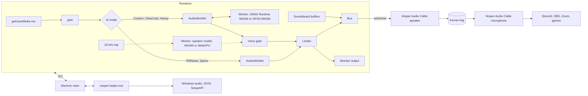

<p align="center">
  
</p>

<h1 align="center">Vesper Audio</h1>

<p align="center">
  Virtual microphone, local AI noise cancellation and soundboard for Windows.<br>
  Your mic goes in, a clean voice-locked signal comes out of <b>Vesper Audio Cable</b>.
</p>

<p align="center">
  <a href="https://github.com/AroseEditor/Vesper-Audio/releases/latest"></a>
  
  
  
  
</p>

```
mic ──> gain ──> AI denoise ──> voice lock ──> limiter ──> Vesper Audio Cable ──> Discord / OBS / Zoom / games
                                                  ^
                                         soundboard (local MP3)
```

---

## Contents

1. [What it is](#what-it-is)
2. [Screens](#screens)
3. [Install](#install)
4. [Quick start](#quick-start)
5. [Features](#features)
6. [AI noise cancellation](#ai-noise-cancellation)
7. [Benchmarks](#benchmarks)
8. [Vesper Audio Cable](#vesper-audio-cable)
9. [Real Windows properties](#real-windows-properties)
10. [Architecture](#architecture)
11. [Build from source](#build-from-source)
12. [CI and releases](#ci-and-releases)
13. [Data and privacy](#data-and-privacy)
14. [Troubleshooting](#troubleshooting)
15. [Honest limits](#honest-limits)
16. [Repository layout](#repository-layout)
17. [Licenses and credits](#licenses-and-credits)

---

## What it is

| Part | What it does |
| --- | --- |
| **Vesper Audio** (Electron app) | Captures your real microphone, cleans it, mixes in the soundboard, and plays the result into the virtual cable. Lives in the system tray. |
| **Vesper Audio Cable** (virtual microphone) | A virtual speaker and a virtual microphone joined by a loopback. Anything written to the speaker comes out of the microphone. Other apps pick the microphone. It runs on the Microsoft-signed [VB-CABLE](https://vb-audio.com/Cable/) driver, renamed and given the Vesper icon, so Secure Boot stays on. A self-signed Vesper driver is kept as an advanced fallback. |
| **vesper-helper.exe** (Rust) | Talks to Windows: lists endpoints, reads and writes the real Sound control panel properties, renames and re-icons the cable endpoints, detects GPUs, verifies driver signatures, installs and removes drivers. |
| **AI models** | DeepFilterNet3 (built in), DPDFNet, and WeSpeaker speaker verification. Downloaded once, executed locally. Nothing leaves the PC. |

---

## Screens

<table>
  <tr>
    <td><br><sub>Home: device, AI noise cancellation, basic noise cancellation, hear yourself</sub></td>
    <td><br><sub>Properties: live Windows control panel values</sub></td>
  </tr>
  <tr>
    <td><br><sub>Sound-Board: up to 40 local MP3s</sub></td>
    <td><br><sub>Settings: startup, tray, driver, voice, routing</sub></td>
  </tr>
  <tr>
    <td><br><sub>Voice enrollment with Start and Stop, English and Hindi</sub></td>
    <td><br><sub>Custom Heavy popup with real GPU detection</sub></td>
  </tr>
  <tr>
    <td><br><sub>AI presets</sub></td>
    <td><br><sub>Install Vesper Audio Cable on the Microsoft-signed VB-CABLE driver</sub></td>
  </tr>
</table>

---

## Install

Download from the [latest release](https://github.com/AroseEditor/Vesper-Audio/releases/latest):

| File | Use |
| --- | --- |
| `Vesper-Audio-Setup-<version>.exe` | NSIS installer. Per-user, no admin needed for the app itself. |
| `Vesper-Audio-<version>-portable.exe` | Single file, no install. |
| `VesperAudioCable-x64.zip` + `.sha256` | The fallback driver package. Only used when VB-CABLE cannot be installed. The app downloads and verifies it. |
| `VesperAudioCable.cer` | Public half of the fallback driver signing certificate. |

Requirements: Windows 10 1903+ or Windows 11, x64. A microphone. Heavy mode additionally needs an NVIDIA GPU with more than 2 GB of VRAM.

The executables are not Authenticode signed, so SmartScreen may warn on first launch.

---

## Quick start

1. Run the app. First launch offers to install **Vesper Audio Cable**. The app downloads VB-CABLE from vb-audio.com, checks its SHA-256 and Microsoft signature, then asks Windows for permission and opens the VB-Audio installer. Press **Install Driver** there. The app renames the devices to Vesper Audio Cable. Secure Boot and Test Mode are not touched.
2. On **Home** pick your microphone, tick **AI Noise Cancellation**, read the paragraph once when asked.
3. In Discord, OBS, Zoom or a game choose **Vesper Audio Cable** as the microphone.
4. Tick **Test and Hear Yourself** to listen to what others hear.

Closing the window sends the app to the tray. Left click the tray icon to open it, right click for **Exit**.

---

## Features

| Area | Detail |
| --- | --- |
| Device detection | Active capture and render endpoints straight from Windows (`IMMDeviceEnumerator`), live refresh on plug and unplug. |
| Properties | Format (rate, bits, channels), Levels, Listen to this device, Audio enhancements. All read and written on the real endpoint. |
| Custom Audio Gain | 0 to 400 percent software gain per microphone, saved per device. |
| AI Noise Cancellation | Presets **Custom**, **Custom Heavy**, **ClearCast**. See below. |
| Basic Noise Cancellation | **Speex** (low CPU usage, low quality) with Suppression Level -60 dB to 0 dB, and **RNNoise** (good quality, more CPU usage). Built from OBS Studio's `noise-suppress-filter.c`: 10 ms frames (480 samples at 48 kHz), Speex through `speex_preprocess_state_init` with `SPEEX_PREPROCESS_SET_NOISE_SUPPRESS` set to the slider dB (default -30), RNNoise on 480-sample frames scaled by 32768, and no makeup gain. Cannot be ticked while AI is on. |
| Test and Hear Yourself | Plays the processed microphone to your chosen output for as long as it is ticked. |
| Soundboard | Local MP3 files, maximum 40. Played through the virtual microphone and your headphones. Mix with your voice. |
| Voice enrollment | Start and Stop, English and Hindi paragraphs, laugh prompt, optional add-a-second-language. |
| Settings | Open at login (hidden to tray), close to tray, re-download driver, uninstall driver, redo paragraph, choose cable and monitor outputs, open repo. |
| Persistence | Everything is saved to `settings.json` and restored on start. |

---

## AI noise cancellation

### Presets

| Preset | Pipeline | Download | Runs on | Notes |
| --- | --- | --- | --- | --- |
| **Custom** | DPDFNet baseline denoiser, then voice lock with a small speaker model | **16.9 MB** (8.7 + 8.2) | CPU | Default. Keeps your voice and laughs, drops other people and noise. |
| **Custom Heavy** | DPDFNet2 fullband 48 kHz denoiser, then voice lock with a 114 MB speaker model | **124.8 MB** (10.5 + 114.3) | CPU denoiser, GPU voice lock | NVIDIA GPU with more than 2 GB VRAM. A popup states this and shows the detected card. |
| **ClearCast** | Same denoiser as Custom, strength slider from 0 to 100 percent | 8.7 MB | CPU | No voice lock. Strength is a leakage floor of up to 45 dB. |

Fallback: if the main model is not downloaded yet, or the CPU cannot keep up for a sustained period, the app switches to the built-in **DeepFilterNet3** and says so.

### How the voice lock works

1. **Enrollment.** Read the paragraph (English or Hindi) in your normal voice and laugh. Accent and speed do not matter, the app learns how you really sound. Press **Stop** after 10 seconds of speech, or let it finish at 34 seconds.
2. **Voiceprint.** 1.6 second windows every 0.4 seconds go through a speaker verification network (80-dim Kaldi fbank, then a 256 or 512 dim embedding). The windows are clustered with k-means into up to 6 centroids, so quiet, loud, fast and relaxed speech each get their own. The match threshold comes from held-out windows: centroids from half of your recording, score the other half, `thr = mean - 2 sd`, floor 0.30, cap 0.40 (Custom) or 0.38 (Heavy). Cutting your own voice is worse than a brief leak, so the cap is conservative.
3. **Live gate.** The gate is open by default and closes only after two consecutive "not you" verdicts (one if the score is far below the reject line). A verdict is the median of the last three scores against your best matching centroid, with separate accept and reject thresholds (`reject = thr - 0.1`) so it does not flutter. Confident matches are kept in a gallery of up to 24 live embeddings, so the voiceprint follows you through the session. Gate gain is smoothed (10 ms attack, 50 ms release).
4. **Strictness.** **Settings, Voice lock strictness** moves both thresholds: Relaxed (-0.06 / -0.08), Balanced (default), Strict (+0.05 / +0.06).
5. **Heavy** waits for a full 1.6 second window before deciding, which is slower to react but steadier.

Measured on 8 LibriSpeech dev-clean speakers (about 38 s of enrollment each, 4 test clips each, mixed with 4 other speakers, CAM++ model, 100 ms chunks). "Me open" is the share of speech frames where the gate is open for the enrolled speaker, "others open" the same for everyone else. Speed shifts stand in for sounding different from the enrollment, which is what an accent or a tired voice does.

| Test audio | Old gate, me open | New gate, me open | Old gate, others open | New gate, others open |
| --- | --- | --- | --- | --- |
| Same conditions | 97% | **100%** | 13% | 38% |
| Speed +/-10% | 79% | **99%** | 13% | 40% |
| Speed +/-20% | 34% | **69%** | 12% | 40% |
| Room reverb | 96% | **100%** | 13% | 37% |
| First second of your speech | 80% | **100%** | | |

The trade is deliberate: the old gate cut the user's own voice far too often, the new one almost never does, and in exchange the first second or so of another person's sentence leaks until two verdicts agree (others are open in 99% of their first second). Strict lowers the leak to about 34% and drops "me open" at +/-20% shift to 48%. Small test set on read speech, so read it as direction, not proof.

Your recording is stored locally as 16 kHz PCM under `voice/` so Heavy can build its own voiceprint without asking you to read again.

### Models (all open source, packaged here, none trained by this project)

| Model | Role | Size | Origin | License |
| --- | --- | --- | --- | --- |
| DPDFNet baseline | Custom, ClearCast denoiser (16 kHz) | 8.7 MB | Ceva-IP/DPDFNet | Apache-2.0 |
| DPDFNet2 48 kHz hr | Heavy denoiser (fullband) | 10.5 MB | Ceva-IP/DPDFNet | Apache-2.0 |
| DeepFilterNet3 | Built-in fallback, compiled to WASM from source | 8.0 MB + 12.7 MB runtime | Rikorose/DeepFilterNet | MIT or Apache-2.0 |
| CAM++ speaker model | Custom voice lock | 8.2 MB (from 29.3 MB) | WeSpeaker via sherpa-onnx | Apache-2.0 |
| ResNet293 speaker model | Heavy voice lock | 114.3 MB | WeSpeaker via sherpa-onnx | Apache-2.0 |
| RNNoise, Speex | Basic presets | bundled | Xiph | BSD |

The CAM++ file is produced by [`tools/quantize_weights.py`](tools/quantize_weights.py): weight-only int8 with a `DequantizeLinear` node per weight. The runtime folds it back to float32 at load, so speed and accuracy stay the same while the file is 3.6x smaller. Dynamic int8 was tested and rejected: it kept accuracy but ran 30x slower in ONNX Runtime Web.

---

## Benchmarks

Everything here was measured in this repository's own harness, on one laptop (Intel iGPU plus RTX 3050 Laptop 4 GB). Treat numbers as indicative, not universal.

### Denoising quality (DNSMOS P.835, higher is better)

6 public speech clips from 3 speakers (about 27 s) mixed at 5 dB SNR with 11 [ESC-50](https://github.com/karolpiczak/ESC-50) noise types: airplane, crying baby, door knock, engine, footsteps, keyboard, mouse click, rain, vacuum cleaner, washing machine, wind. Scored with Microsoft DNSMOS (calibrated polyfit) at 16 kHz.

| Processing | SIG | BAK | OVRL |
| --- | --- | --- | --- |
| Noisy input | 3.04 | 2.02 | 2.06 |
| DeepFilterNet3 (fallback) | 2.74 | 3.74 | 2.43 |
| **DPDFNet baseline 16 kHz (Custom)** | **3.31** | **4.02** | **3.00** |
| DPDFNet2 16 kHz | 3.35 | 4.01 | 3.03 |
| DPDFNet4 16 kHz | 3.34 | 3.99 | 3.01 |
| DPDFNet2 48 kHz (Heavy) | 3.30 | 3.98 | 2.98 |
| DPDFNet8 48 kHz | 3.34 | 3.97 | 3.00 |
| Clean speech reference | 3.48 | 3.48 | 2.91 |

Takeaway: the 8.7 MB baseline scores the same as the 8-block model, so it is the default. DNSMOS runs at 16 kHz and cannot reward fullband output, which is the reason Heavy exists.

### Cost per 10 ms frame

| Model | Device | Time |
| --- | --- | --- |
| DeepFilterNet3 | CPU, WASM SIMD, Node | 1.5 ms |
| DPDFNet baseline | CPU, WASM, in the app | 1.1 ms |
| DPDFNet2 48 kHz | CPU, WASM in the app / native | 4.0 / 3.2 ms |
| DPDFNet8 48 kHz | CPU native / DirectML / WebGPU | 7.8 / 20 / 121 ms |

Streaming frames are latency bound, not throughput bound, so a GPU does not help the denoiser. That is why denoising stays on the CPU and the GPU is spent where it pays:

| Voice model, 1.6 s window | CPU | GPU (WebGPU, RTX 3050 Laptop) |
| --- | --- | --- |
| CAM++ small | about 90 ms | not needed |
| ResNet293 | about 6000 ms | **151 ms** (40x) |

### Speaker separation (held-out windows)

| Model | Me (min to mean) | Others (mean to max) |
| --- | --- | --- |
| CAM++ small | 0.55 to 0.68 | 0.28 to 0.42 |
| ResNet293 | 0.48 to 0.66 | 0.19 to 0.32 |

Small test set, so read it as direction, not proof. The live gate results are in [How the voice lock works](#how-the-voice-lock-works).

### Latency

| Path | Microphone to cable |
| --- | --- |
| Custom, ClearCast | about 82 ms (DPDFNet has about 4 frames of built-in lookahead, plus 20 ms jitter buffer) |
| DeepFilterNet3 fallback | about 52 ms |

Pick **Basic Noise Cancellation** when latency matters more than quality.

### Test suites

* `npm test` runs 13 checks against a synthetic noise file: boot, pages, Windows endpoints, noise reduction per mode, soundboard, close to tray, persistence.
* A 60+ control UI audit drives every button, dropdown, slider and dialog, including real writes to the Windows volume, Listen and Enhancements properties (restored afterwards).

---

## Vesper Audio Cable

### Default: VB-CABLE, signed by Microsoft

| Property | Value |
| --- | --- |
| Driver | VB-CABLE Driver Pack 45 by VB-Audio Software, donationware, [vb-cable.com](https://vb-audio.com/Cable/) |
| Signature | catalog and `.sys` signed by `Microsoft Windows Hardware Compatibility Publisher`, so it loads with Secure Boot on and without Test Mode |
| Hardware ID | `VBAudioVACWDM` |
| Source | `https://download.vb-audio.com/Download_CABLE/VBCABLE_Driver_Pack45.zip`, pinned SHA-256 `b950e39f01af1d04ea623c8f6d8eb9b6ea5c477c637295fabf20631c85116bfb` |
| Checks | hash must match, then `Get-AuthenticodeSignature` on the catalog must report a valid Microsoft signature, otherwise nothing is run |
| Install | the app launches the official `VBCABLE_Setup_x64.exe` with administrator approval and VB-Audio's own window and licence. You press **Install Driver** |
| Branding | after install the helper rewrites the endpoint properties in the Windows property store (`DeviceDesc`, adapter name, friendly name, icon) to **Vesper Audio Cable** with the Vesper icon. The driver package is never modified. It is re-applied on launch if Windows restores the original names |

Why the install is not silent and the package is not in this repository: the VB-CABLE licence allows copying the package as is, and does not allow integrating it into another software's installation procedure without the author's agreement. The app therefore downloads the official package, shows VB-Audio's installer, and leaves the licence acceptance to you. Device Manager and the Apps list still show VB-Audio because the signed package cannot be edited without breaking its signature. If you use the cable, please [donate to VB-Audio](https://vb-audio.com/Cable/).

| State | App behavior |
| --- | --- |
| Endpoints present | Nothing to do, no banner. |
| Cable devices named `CABLE Input` or `CABLE Output` | Renamed to Vesper Audio Cable with the Vesper icon. |
| VB-Audio installer closed, devices not there yet | Offers a 15 second restart you can cancel. |
| Driver installed but no endpoints | Banner **Repair** runs setup again. |

### Fallback: the Vesper driver

For the rare PC where VB-CABLE cannot be used. **Settings, Fallback driver** or **Use fallback driver** in the install window. It is a fork of [VirtualDrivers/Virtual-Audio-Driver](https://github.com/VirtualDrivers/Virtual-Audio-Driver) (MIT, derived from Microsoft's SysVAD sample), renamed and extended with a loopback.

| Property | Value |
| --- | --- |
| Hardware ID | `ROOT\VesperAudioCable` |
| Format | fixed 48 kHz, 16-bit PCM, stereo on both endpoints (so the ring never converts) |
| Loopback | render stream `ReadBytes` writes into a 256 KB spin-locked ring, capture stream `WriteBytes` reads from it |
| Latency | primes at 20 ms, trims to 20 ms above 120 ms, discards when nobody is recording for 500 ms |
| Package | `.sys` (about 64 KB), `.inf`, `.cat`, `.cer`, built on GitHub Actions with the WDK |

There is no Microsoft attestation signature for it. It is signed with one shared self-signed certificate (subject `CN=Vesper Audio, O=Vesper Audio`, thumbprint `8F4206F58271F2A11BD13C374636B122569AA265`, private key only in the GitHub Actions secrets `VAC_SIGN_PFX` and `VAC_SIGN_PASSWORD`). The installer imports the public certificate into **Trusted Root** and **Trusted Publishers**. Windows loads an unsigned-by-Microsoft kernel driver only in **Test Mode**, and Test Mode needs **Secure Boot** off, so this path alone needs firmware changes:

| State | App behavior |
| --- | --- |
| Secure Boot on, Test Mode off | Dialog with the exact steps: Settings, System, Recovery, Advanced startup, Restart now, Troubleshoot, Advanced options, UEFI Firmware Settings, set Secure Boot to Disabled, then Install again. Button to open the recovery page and a recheck button. |
| Test Mode just switched on | Install succeeded, restart required. |
| Device present with a problem code | Shows the code and next steps. |


Kernel anti-cheat games (Vanguard, FACEIT and similar) may refuse to run while Secure Boot is off. **Settings** has Uninstall for either driver.

---

## Real Windows properties

| Control | Mechanism |
| --- | --- |
| Format, channels | `PKEY_AudioEngine_DeviceFormat` from the endpoint property store |
| Levels | `IAudioEndpointVolume` master scalar |
| Listen to this device | endpoint property `{24dbb0fc-9311-4b3d-9cf0-18ff155639d4},1` |
| Allow processing or bypass (audio enhancements) | undocumented `IPolicyConfig::SetPropertyValue` on the FX store, key `PKEY_AudioEndpoint_Disable_SysFx` `{1da5d803-d492-4edd-8c23-e0c0ffee7f0e},5` |
| GPU detection | DXGI adapters (vendor id, dedicated VRAM) |

None of these need administrator rights. The Sound control panel and the app always agree because the app reads the same store and polls for changes.

---

## Architecture



* The audio engine lives in the renderer with `backgroundThrottling` off, so it keeps running while the window is hidden in the tray.
* Denoisers run in a Worker connected to an AudioWorklet by a `MessageChannel`, with a two-hop jitter buffer. A watchdog drops to the light model if the worker falls behind.
* Models are fetched on demand with SHA-256 verification and stored under `models/`.

---

## Build from source

Prerequisites: Node 22, Rust stable, `rustup target add wasm32-unknown-unknown`, `cargo install wasm-bindgen-cli --version 0.2.92 --locked`.

```powershell
npm ci
npm run build:df
npm run helper
npm start
npm test
npm run dist
```

| Script | Does |
| --- | --- |
| `build:df` | Clones DeepFilterNet at a pinned commit, builds its WASM with SIMD, downloads and checks the model. |
| `helper` | Builds `vesper-helper.exe` with Cargo. |
| `start` | Runs the app. In this repo's shell `ELECTRON_RUN_AS_NODE` must be unset. |
| `test` | Launches the real app with a fake audio device and checks behavior. |
| `dist` | NSIS installer and portable exe into `dist/`. |

The driver needs the Windows Driver Kit and Visual Studio 2022. It is built by CI (`windows-2022`), not locally.

---

## CI and releases

`.github/workflows/release.yml` builds everything and attaches it to one release.

| Job | Output |
| --- | --- |
| `driver` | WDK build, sign `.sys`, regenerate and sign `.cat`, zip with the certificate, SHA-256 file |
| `app` | DeepFilterNet WASM, Rust helper, NSIS installer, portable exe |
| `publish` | One GitHub release with all assets |

```powershell
git tag v1.0.0
git push origin v1.0.0
```

Manual runs (`workflow_dispatch`) take `target` (`all`, `driver`, `app`) and `publish` (default false), so a build can be checked without releasing. The `models-v1` release holds the quantized speaker model.

---

## Data and privacy

Everything runs on your PC. The only network traffic is downloads: the VB-CABLE package from vb-audio.com, the fallback driver, models, and the release lookup. No telemetry.

| Path (`%APPDATA%\Vesper Audio`) | Content |
| --- | --- |
| `settings.json` | All settings, voiceprints |
| `voice/` | Your enrollment recordings, 16 kHz PCM |
| `sounds/` | Copies of your soundboard files |
| `models/` | Downloaded models |

Delete `voice/` and `settings.json` to forget your voice.

---

## Troubleshooting

| Symptom | Cause and fix |
| --- | --- |
| Vesper Audio Cable not in other apps | Check the banner on Home. Install not finished: press **Install**. Restart needed: press **Restart**. |
| Fallback driver, problem code 52 | Windows rejected the self-signed driver. Test Mode must be on and Secure Boot off, or use the default VB-CABLE driver. |
| Banner says code 10, 31, 37 or 39 | Press **Fix**, or Settings, **Re-init and Setup**. |
| Other apps hear nothing | Pick **Vesper Audio Cable** as the microphone in that app, and check the Home level meter moves. |
| "Using the built-in light model" | The main model is still downloading, you are offline, or the CPU could not keep up. |
| Custom Heavy says restart | Windows must run the app on the NVIDIA GPU. Press **Restart now** once. |
| Heavy missing from the menu | No NVIDIA GPU with more than 2 GB VRAM was found. |
| Echo or feedback | **Test and Hear Yourself** is on with speakers. Use headphones or untick it. |

---

## Honest limits

* The models are open source and were not trained by this project. The pipeline around them (enrollment, held-out threshold, gate, mixing, fallbacks) is this project's work. There is **no head-to-head claim against NVIDIA Broadcast or any commercial product**. The benchmark compares open models.
* There is no Microsoft-signed Vesper driver. The default cable is VB-CABLE, which is signed by Microsoft and downloaded from VB-Audio. The Vesper kernel loopback compiles and is signed by CI with a self-signed certificate, and has not been exercised on the author's PC (Secure Boot on). Treat it as a fallback and report problems.
* Custom needs about one second of speech to decide, so the very start of someone else's sentence can leak, and a very short utterance may be judged late.
* Fixed 48 kHz 16-bit stereo. Apps that force exclusive mode with another format cannot open the cable.
* Heavy relies on WebGPU, which Chromium exposes on supported drivers.

---

## Repository layout

```
.github/workflows/release.yml   build and release everything
driver/                         WDM driver fork (Source/, Package/, certificate)
helper/                         Rust helper: audio endpoints, GPUs, driver install
scripts/                        vendor.js, build-df.js, test.js
src/main.js, preload.js         Electron main process, tray, IPC
src/driver.js, models.js        driver and model downloaders
src/ui/                         interface, audio engine, workers, voice lock
tools/quantize_weights.py       weight-only int8 for the speaker model
docs/                           screenshots
```

---

## Licenses and credits

This project: MIT (see [LICENSE](LICENSE)). Developed by Ayush.ue5.

| Component | License |
| --- | --- |
| Electron, ONNX Runtime | MIT |
| DeepFilterNet | MIT or Apache-2.0 |
| DPDFNet (Ceva-IP) | Apache-2.0 |
| WeSpeaker and 3D-Speaker models, sherpa-onnx releases | Apache-2.0 |
| @sapphi-red/web-noise-suppressor, RNNoise, SpeexDSP | MIT, BSD-3-Clause |
| Virtual-Audio-Driver (MikeTheTech) | MIT |
| VB-CABLE | VB-Audio Software, donationware, downloaded from vb-audio.com at install time and never redistributed here |
| Microsoft SysVAD sample | MS-PL |
| Inter font | OFL-1.1 |
| Lucide icons | ISC |
| Microsoft DNSMOS, ESC-50 | benchmarking only, not redistributed |

The files under `driver/Source` keep their original headers and notices as required by the upstream licenses.
