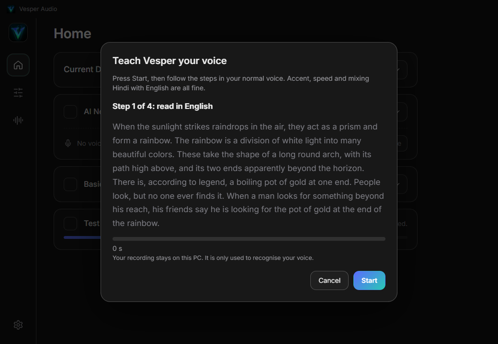
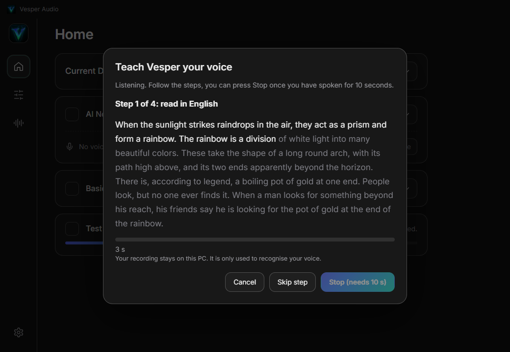
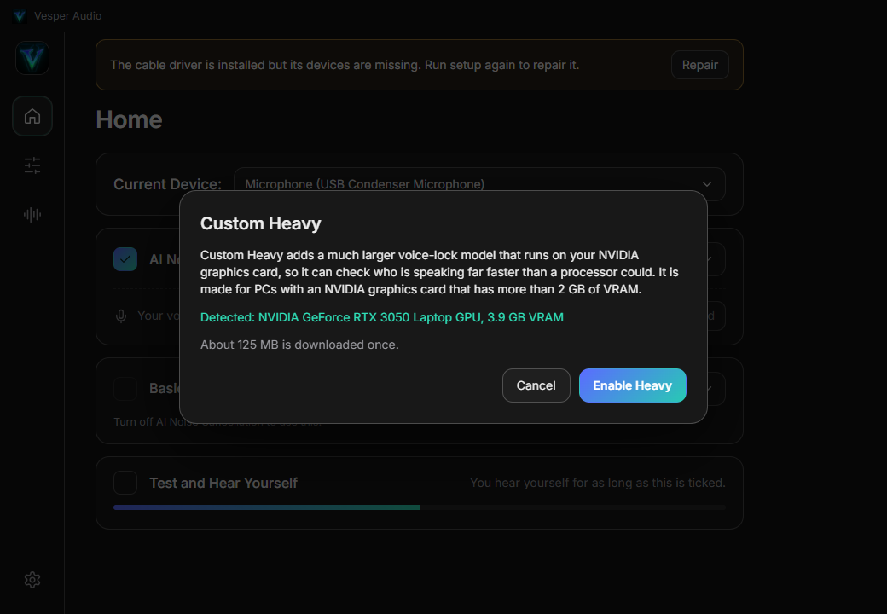
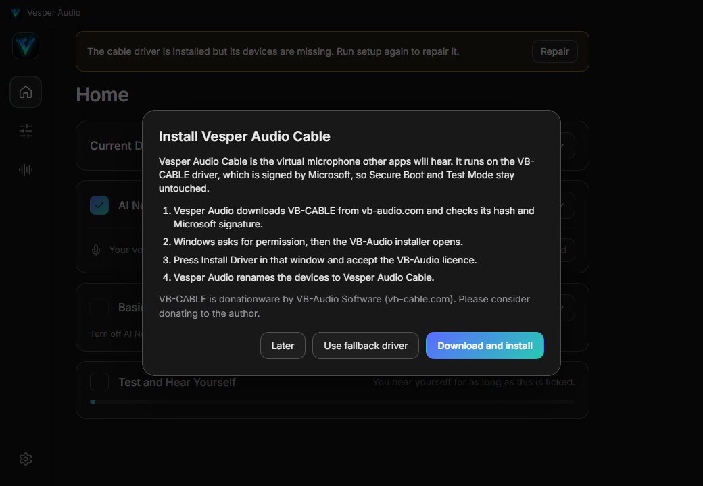
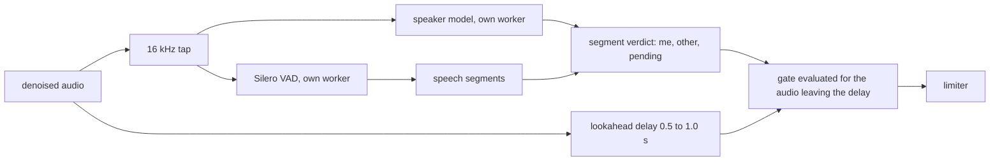
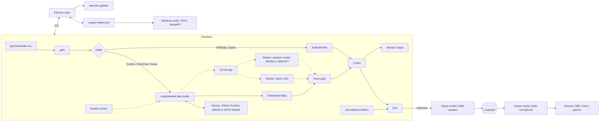

<p align="center">
  
</p>

<h1 align="center">Vesper Audio</h1>

<p align="center">
  A virtual microphone for Windows with local AI noise cancellation, a voice lock that only passes <i>your</i> voice, and a soundboard.<br>
  Your mic goes in, a clean signal comes out of <b>Vesper Audio Cable</b>. Nothing leaves your PC.
</p>

<p align="center">
  <a href="https://github.com/AroseEditor/Vesper-Audio/releases/latest"></a>
  
  
  
  
  
</p>

```
mic -> gain -> AI denoise -> voice lock -> limiter -> Vesper Audio Cable -> Discord / OBS / Zoom / games
         (30 ms adaptive    (speech detector,   ^
          jitter buffer)     lookahead delay)   soundboard (local MP3s)
```

---

## Contents

1. [What's new in 1.1.0](#whats-new-in-110)
2. [What it is](#what-it-is)
3. [Screens](#screens)
4. [Install and updates](#install-and-updates)
5. [Quick start](#quick-start)
6. [Features](#features)
7. [AI noise cancellation](#ai-noise-cancellation)
8. [Voice lock](#voice-lock)
9. [Reliable audio](#reliable-audio)
10. [Vesper Audio Cable](#vesper-audio-cable)
11. [Real Windows properties](#real-windows-properties)
12. [Benchmarks](#benchmarks)
13. [Architecture](#architecture)
14. [Build from source](#build-from-source)
15. [CI and releases](#ci-and-releases)
16. [Data and privacy](#data-and-privacy)
17. [Troubleshooting](#troubleshooting)
18. [Honest limits](#honest-limits)
19. [Repository layout](#repository-layout)
20. [Licenses and credits](#licenses-and-credits)

---

## What's new in 1.1.0

Version 1.1.0 is a reliability and accuracy release. Every item below came from a real complaint about 1.0.0.

| Problem in 1.0.0 | Cause found | What changed |
| --- | --- | --- |
| Voice tears or stutters now and then | The denoiser hands audio to the sound card through a 20 ms buffer. When the CPU was busy (a game, OBS) a late block was replaced by hard zeros. | Adaptive jitter buffer with fades instead of hard zeros, no memory allocation on the audio thread, High process priority, no background throttling. Under 20 busy threads: **0 dropouts** (1.0.0: 32 dropouts in 15 s on Custom, Heavy fell back and was silent for about 84 percent of the run). |
| Breaths, air blows and wind leak in | Speech was detected by volume, and the gate stayed open for 0.4 s after you stopped. | Real speech detector ([Silero VAD](https://github.com/snakers4/silero-vad)). Breathing, wind, sneezes, clicks and mic blows score 0 to 1 percent speech. |
| Other voices leak, even on Strict | The gate opened first and decided about one second later. | A lookahead delay: audio is held for 0.5 to 1.0 s so the verdict applies to the first word. On Strict, other voices pass about **5 to 10 percent** of the time (1.0.0: the first second always leaked). |
| Strict does not recognise my voice | Thresholds were calibrated on 1.6 s windows but the first decision used 0.5 s windows, which score far lower for the same person. | Thresholds depend on window length. Enrollment now covers English, Hindi and free talk. |
| Voice cuts out mid sentence | One bad score closed the gate for the rest of the sentence. | One verdict per speech segment. Once you are recognised it takes three clearly wrong scores to switch. |
| Noise cancellation stops after the mic is idle | Not reproduced with silence alone (120 s of silence and 7 minutes hidden in the tray both recovered). Likely a stalled worker, a frozen USB mic, a lost device or sleep. | A health monitor restarts what broke, see [Reliable audio](#reliable-audio). |
| Cable showed "VB-Audio Virtual Cable" after install | Branding wrote the name but not the adapter text, and never retried. | Branding is idempotent and finishes half-branded devices. |
| Manual updates | | In-app updater for the installer build, a notice for the portable build. |

---

## What it is

| Part | What it does |
| --- | --- |
| **Vesper Audio** (Electron app) | Captures your real microphone, cleans it, voice-locks it, mixes in the soundboard and plays the result into the virtual cable. Lives in the system tray. |
| **Vesper Audio Cable** (virtual microphone) | A virtual speaker and a virtual microphone joined by a loopback. Anything written to the speaker comes out of the microphone, and other apps pick the microphone. It runs on the Microsoft-signed [VB-CABLE](https://vb-audio.com/Cable/) driver, renamed and given the Vesper icon, so Secure Boot stays on. A self-signed Vesper driver is kept as an advanced fallback. |
| **vesper-helper.exe** (Rust) | Talks to Windows: lists endpoints, reads and writes the real Sound control panel properties, renames and re-icons the cable, detects GPUs, verifies driver signatures, installs and removes drivers. |
| **AI models** | DPDFNet and DeepFilterNet3 denoisers, WeSpeaker speaker verification, Silero speech detection. Downloaded once or bundled, executed locally. |

---

## Screens

<table>
  <tr>
    <td><br><sub>Home: device, AI noise cancellation, basic noise cancellation, hear yourself</sub></td>
    <td><br><sub>Properties: live Windows control panel values</sub></td>
  </tr>
  <tr>
    <td><br><sub>Sound-Board: up to 40 local MP3s</sub></td>
    <td><br><sub>Settings: updates, drivers, voice lock strictness, routing</sub></td>
  </tr>
  <tr>
    <td><br><sub>Guided enrollment, step 1 of 4</sub></td>
    <td><br><sub>Recording: words light up as you read, Skip step, Stop after 10 s</sub></td>
  </tr>
  <tr>
    <td><br><sub>Custom Heavy popup with real GPU detection</sub></td>
    <td><br><sub>Install Vesper Audio Cable on the Microsoft-signed VB-CABLE driver</sub></td>
  </tr>
</table>

---

## Install and updates

Download from the [latest release](https://github.com/AroseEditor/Vesper-Audio/releases/latest):

| File | Use |
| --- | --- |
| `Vesper-Audio-Setup-<version>.exe` | NSIS installer. Per-user, no admin needed for the app itself. Updates itself. |
| `Vesper-Audio-<version>-portable.exe` | Single file, no install. Tells you when a newer release exists. |
| `latest.yml`, `*.blockmap` | Update metadata read by the installer build. |
| `VesperAudioCable-x64.zip` + `.sha256`, `VesperAudioCable.cer` | The fallback driver package. Only used when VB-CABLE cannot be installed. |

Requirements: Windows 10 1903+ or Windows 11, x64, a microphone. Heavy mode also needs an NVIDIA GPU with more than 2 GB of VRAM.

The executables are not Authenticode signed, so SmartScreen may warn on first launch.

**Updates.** The installer build checks GitHub 20 seconds after launch and every 6 hours, downloads a newer version in the background (hash checked against `latest.yml`) and shows **Restart to update**. The portable build cannot replace itself, so it shows **Download**. **Settings, Updates** has a manual check. Installing 1.1.0 over 1.0.0 keeps your settings, voiceprint and sounds.

---

## Quick start

1. Run the app. First launch offers to install **Vesper Audio Cable**. The app downloads VB-CABLE from vb-audio.com, checks its SHA-256 and Microsoft signature, asks Windows for permission and opens the VB-Audio installer. Press **Install Driver** there. The app then renames the devices to Vesper Audio Cable. Secure Boot and Test Mode are not touched.
2. On **Home** pick your microphone and tick **AI Noise Cancellation**. First time, the app asks you to record your voice (about 40 seconds, four short steps).
3. In Discord, OBS, Zoom or a game choose **Vesper Audio Cable** as the microphone.
4. Tick **Test and Hear Yourself** to listen to what others hear.

Closing the window sends the app to the tray. Left click the tray icon to open it, right click for **Exit**.

---

## Features

| Area | Detail |
| --- | --- |
| Device detection | Active capture and render endpoints straight from Windows (`IMMDeviceEnumerator`), live refresh on plug and unplug. |
| Properties | Format (rate, bits, channels), Levels, Listen to this device, Audio enhancements. All read and written on the real endpoint. |
| Custom Audio Gain | 0 to 400 percent software gain per microphone, saved per device. |
| AI Noise Cancellation | Presets **Custom**, **Custom Heavy**, **ClearCast**. See below. |
| Basic Noise Cancellation | **Speex** (low CPU usage, low quality) with Suppression Level -60 dB to 0 dB, and **RNNoise** (good quality, more CPU usage). Built from OBS Studio's `noise-suppress-filter.c`: 10 ms frames (480 samples at 48 kHz), Speex through `speex_preprocess_state_init` with `SPEEX_PREPROCESS_SET_NOISE_SUPPRESS` set to the slider dB (default -30), RNNoise on 480-sample frames scaled by 32768, no makeup gain. Cannot be ticked while AI is on. |
| Voice lock strictness | **Relaxed**, **Balanced**, **Strict**, each stating its delay. |
| Test and Hear Yourself | Plays the processed microphone to your chosen output for as long as it is ticked. |
| Soundboard | Local MP3 files, maximum 40. Played through the virtual microphone and your headphones, mixed with your voice. |
| Voice enrollment | One guided session: read English, read Hindi, talk freely, laugh. Skip any step, Stop after 10 s. |
| Settings | Open at login (hidden to tray), close to tray, updates, re-init or uninstall the driver, fallback driver, redo voice, choose cable and monitor outputs, open repo. |
| Persistence | Everything is saved to `settings.json` and restored on start. |

---

## AI noise cancellation

| Preset | Pipeline | Download | Runs on | Notes |
| --- | --- | --- | --- | --- |
| **Custom** | DPDFNet baseline denoiser, then voice lock with a small speaker model | **16.9 MB** (8.7 + 8.2) | CPU | Default. Keeps your voice and laughs, drops other people, breaths and noise. |
| **Custom Heavy** | DPDFNet2 fullband 48 kHz denoiser, then voice lock with a 114 MB speaker model | **124.8 MB** (10.5 + 114.3) | CPU denoiser, GPU voice lock | NVIDIA GPU with more than 2 GB VRAM. A popup states this and shows the detected card. |
| **ClearCast** | Same denoiser as Custom, strength slider 0 to 100 percent | 8.7 MB | CPU | No voice lock. Strength is a leakage floor of up to 45 dB. |

Fallback: if the main model is not downloaded yet, or the CPU cannot keep up for a sustained period, the app switches to the built-in **DeepFilterNet3** without a gap in the audio and says so.

### Models (open source, none trained by this project)

| Model | Role | Size | Origin | License |
| --- | --- | --- | --- | --- |
| DPDFNet baseline | Custom, ClearCast denoiser (16 kHz) | 8.7 MB | Ceva-IP/DPDFNet | Apache-2.0 |
| DPDFNet2 48 kHz hr | Heavy denoiser (fullband) | 10.5 MB | Ceva-IP/DPDFNet | Apache-2.0 |
| DeepFilterNet3 | Built-in fallback, compiled to WASM from source | 8.0 MB + 12.7 MB runtime | Rikorose/DeepFilterNet | MIT or Apache-2.0 |
| CAM++ speaker model | Custom voice lock | 8.2 MB (from 29.3 MB) | WeSpeaker via sherpa-onnx | Apache-2.0 |
| ResNet293 speaker model | Heavy voice lock | 114.3 MB | WeSpeaker via sherpa-onnx | Apache-2.0 |
| Silero VAD v5 | Speech detection for the gate and enrollment | 2.3 MB, bundled in the app | snakers4/silero-vad | MIT |
| RNNoise, Speex | Basic presets | bundled | Xiph | BSD |

The CAM++ file is produced by [`tools/quantize_weights.py`](tools/quantize_weights.py): weight-only int8 with a `DequantizeLinear` node per weight. The runtime folds it back to float32 at load, so speed and accuracy stay the same while the file is 3.6x smaller. Dynamic int8 was tested and rejected: it kept accuracy but ran 30x slower in ONNX Runtime Web.

---

## Voice lock

The voice lock decides, for each stretch of speech, whether it is you. It never touches the audio itself, it only opens and closes a smoothed gate in front of the limiter.



1. **Enrollment.** One guided session: read an English paragraph (12 s of speech), read a Hindi paragraph (12 s), talk freely in whatever mix of languages you use (10 s), laugh (3 s). Speech is picked by the VAD, so breaths and room noise never enter your voiceprint. Skip any step, or press **Stop** after 10 s. Accent, speed and mixing Hindi with English are fine.
2. **Voiceprint.** 1.6 s windows every 0.4 s go through a speaker verification network (80-dim Kaldi fbank, then a 256 or 512 dim embedding). The windows are clustered with k-means into up to 6 centroids, so quiet, loud, fast and relaxed speech each get their own. The base threshold comes from held-out windows: centroids from half of your recording, score the other half, `thr = mean - 2 sd`, floor 0.30, cap 0.40 (Custom) or 0.38 (Heavy).
3. **Speech segments.** The VAD scores every 32 ms frame (on at 0.5, off at 0.35). A segment ends 0.25 s after the last speech frame. Breaths, wind, clicks and keyboard never start a segment.
4. **Verdict per segment.** While a segment grows, embeddings of its last 0.5 to 1.6 s are scored against your centroids and a gallery of up to 24 live embeddings of you. Short windows score lower for the same person, so the accept threshold rises with the window length (`accept - 0.15 x (1.6 - seconds)`, never below the level's floor). A verdict needs two agreeing scores, "other" is only allowed after 0.9 s of speech (1.2 s on Heavy), and once you are recognised it takes three clearly wrong scores to flip.
5. **Lookahead.** The audio is delayed by 0.5 / 0.8 / 1.0 s while the verdict is computed. The gate for each moment is evaluated when that audio leaves the delay, so a verdict reached half a second late still applies to the first word. That is what stops other people's first words leaking, and what stops your own first word being clipped.
6. **Gate gain** is smoothed (8 ms attack, 40 ms release).

### Strictness

**Settings, Voice lock strictness.** The delay is the price of knowing who is talking before the word leaves.

| Level | Delay | Pending speech | Behavior |
| --- | --- | --- | --- |
| Relaxed | 0.5 s | passes | Never cuts you. Other voices leak in when the app is unsure. |
| **Balanced** (default) | 0.8 s | passes only right after you spoke | Keeps your voice, blocks most other people and all breaths. |
| Strict | 1.0 s | blocked | Blocks other voices hardest. Best for streaming and recording. |

### Measured

Offline, 8 LibriSpeech dev-clean speakers (about 38 s of enrollment each), each test stream has two of their long clips, other speakers, and non-speech (ESC-50 breathing, wind, coughs, sneezes, clicks, keyboard, footsteps, snoring, plus synthetic mic blows). CAM++ model. "Me open" is the share of your speech frames where the gate is open, "others open" the same for other speakers. Speed shifts stand in for sounding different from your enrollment.

| Level | Me open: same, room, speed +/-10% | Others open: same, room, +/-10% | First second of others | Non-speech open |
| --- | --- | --- | --- | --- |
| Relaxed | 98%, 99%, 98% | 50%, 51%, 51% | 88% | 2% |
| **Balanced** | 98%, 99%, 96% | 20%, 20%, 16% | 29% | 1% |
| Strict | 98%, 98%, 93% | 10%, 5%, 6% | 5% | 0% |
| 1.0.0 gate (reference) | 97%, 96%, 79% | 13%, 13%, 13% | 57% | not measured |

Through the real app (fake microphone, real denoiser, VAD worker, delay and gate gain, one speaker, a 94 s file):

| Run | Measured delay | Me passed | Others passed | Non-speech passed |
| --- | --- | --- | --- | --- |
| Custom, Balanced | 0.86 s | 91% | 28% | 0% |
| Custom, Strict | 1.10 s | 90% | 0% | 0% |
| Heavy, Balanced | 0.86 s | 85%* | 7% | 0% |
| Heavy, Strict | not completed, see [Honest limits](#honest-limits) | | | |

\* That run included one spurious noise-cancellation restart caused by a stall rule that was replaced afterwards.

Small test set of English read speech, so read it as direction, not proof. It has not been measured on Hindi.

<details>
<summary>Why the threshold depends on the window length</summary>

Cosine score of the same speaker against their own centroids grows with the amount of speech in the window, other speakers stay near 0.17 at every length (CAM++, 8 speakers):

| Window | Me, mean (sd) | Me, 10th percentile | Others, mean | Others, 99th percentile |
| --- | --- | --- | --- | --- |
| 0.5 s | 0.45 (0.16) | 0.19 | 0.16 | 0.45 |
| 0.8 s | 0.56 (0.10) | 0.43 | 0.17 | 0.47 |
| 1.0 s | 0.61 (0.09) | 0.47 | 0.20 | 0.51 |
| 1.6 s | 0.72 (0.07) | 0.65 | 0.18 | 0.49 |

A single threshold calibrated on 1.6 s windows rejects the owner's own first half second, which is exactly the "I have to repeat words" failure of 1.0.0. Cohort score normalisation was tested and rejected (pooled error 6.9 to 5.2 percent clean, but 24 to 29 percent worse under a speed shift).
</details>

<details>
<summary>Speech detector on non-speech sounds (Silero VAD, share of 32 ms frames scored as speech)</summary>

| Audio | Frames scored as speech |
| --- | --- |
| LibriSpeech read speech | 73 to 92 percent (the rest is pauses) |
| Breathing | 0 to 1 percent |
| Wind | 0 percent |
| Coughing | 0 to 7 percent |
| Sneezing, mouse click, keyboard, footsteps, brushing teeth | 0 percent |
| Snoring | 0 to 4 percent |
| Synthetic mic blows (8 clips, 0.25 to 0.7 s, loud) | 0 percent |

The model costs about 0.26 ms per frame on the CPU, in its own worker so a slow speaker model can never delay it.
</details>

Your recording is stored locally as 16 kHz PCM under `voice/` so Heavy can build its own voiceprint without asking you to record again.

---

## Reliable audio

A noise canceller that glitches is worse than none, so the audio path is built to survive a busy PC.

| Measure | What it does |
| --- | --- |
| Adaptive jitter buffer | The denoiser worker hands 10 ms blocks to the audio thread. The buffer starts at 30 ms. A late block grows it (up to 90 ms) instead of dropping audio, and it shrinks back during quiet. Underruns and refills are faded, never hard zeros. |
| No allocation on the audio thread | Blocks are recycled through a pool, so garbage collection cannot stall the audio callback. |
| High process priority | The app and its renderer, GPU and audio processes run at High priority (`os.setPriority`, no admin needed), so a game at normal priority does not starve the denoiser. |
| No background throttling | Renderer backgrounding, timer throttling and occlusion tracking are off, and `prevent-app-suspension` is held, so a window hidden in the tray keeps full speed. |
| Dither | A signal at -110 dBFS is added in front of the denoiser so long digital silence cannot push its filters into slow denormal numbers. |
| Seamless swaps | Changing preset or falling back to the light model builds the new chain first and removes the old one after 90 ms, so there is no gap. |
| Self healing | Checked every 2 s: audio context suspended, microphone track ended, microphone frozen on digital silence for 30 s, denoise worker no longer delivering audio, worklet processor error, worker crash. Also on Windows wake and unlock, and when audio devices change. |

Verified failures (scratch harness, Custom): killing the denoise worker is detected and restarted in about 6 s, a suspended audio context resumes immediately, a stopped microphone track is reconnected in about 4 s.

Dropouts, 15 s of speech in noise, i7-12650H (16 threads) with busy loops on 12 and 20 threads:

| Build | Custom | Heavy |
| --- | --- | --- |
| 1.0.0, 12 busy threads | 32 dropouts (0.23 s of zeros) | fell back to the light model, 84% of samples were zero |
| 1.1.0, 12 busy threads | **0** | **0**, no fallback |
| 1.1.0, 20 busy threads | **0** | **0**, 1 small step |

---

## Vesper Audio Cable

### Default: VB-CABLE, signed by Microsoft

| Property | Value |
| --- | --- |
| Driver | VB-CABLE Driver Pack 45 by VB-Audio Software, donationware, [vb-cable.com](https://vb-audio.com/Cable/) |
| Signature | catalog and `.sys` signed by `Microsoft Windows Hardware Compatibility Publisher`, so it loads with Secure Boot on and without Test Mode |
| Hardware ID | `VBAudioVACWDM` |
| Source | `https://download.vb-audio.com/Download_CABLE/VBCABLE_Driver_Pack45.zip`, pinned SHA-256 `b950e39f01af1d04ea623c8f6d8eb9b6ea5c477c637295fabf20631c85116bfb` |
| Checks | the hash must match, then `Get-AuthenticodeSignature` on the catalog must report a valid Microsoft signature, otherwise nothing is run |
| Install | the app launches the official `VBCABLE_Setup_x64.exe` with administrator approval and VB-Audio's own window and licence. You press **Install Driver** |
| Branding | the helper rewrites the endpoint properties in the Windows property store (device name, adapter name, friendly name, icon) to **Vesper Audio Cable (Vesper Audio)** with the Vesper icon. The driver package is never modified. Endpoints that still say VB-Audio are finished on the next launch |

Why the install is not silent and the package is not in this repository: the VB-CABLE licence allows copying the package as is, and does not allow integrating it into another software's installation procedure without the author's agreement. The app therefore downloads the official package, shows VB-Audio's installer, and leaves the licence acceptance to you. Device Manager and the Apps list still show VB-Audio because the signed package cannot be edited without breaking its signature. If you use the cable, please [donate to VB-Audio](https://vb-audio.com/Cable/).

| State | App behavior |
| --- | --- |
| Endpoints present | Nothing to do, no banner. |
| Cable devices named `CABLE Input`, `CABLE Output` or still carrying VB-Audio | Renamed to Vesper Audio Cable with the Vesper icon (only when Vesper installed the cable). |
| VB-Audio installer closed, devices not there yet | Offers a 15 second restart you can cancel. |
| Driver installed but no endpoints | Banner **Repair** runs setup again. |

### Fallback: the Vesper driver

For the rare PC where VB-CABLE cannot be used. **Settings, Fallback driver** or **Use fallback driver** in the install window. A fork of [VirtualDrivers/Virtual-Audio-Driver](https://github.com/VirtualDrivers/Virtual-Audio-Driver) (MIT, derived from Microsoft's SysVAD sample), renamed and extended with a loopback.

| Property | Value |
| --- | --- |
| Hardware ID | `ROOT\VesperAudioCable` |
| Format | fixed 48 kHz, 16-bit PCM, stereo on both endpoints (so the ring never converts) |
| Loopback | render stream `ReadBytes` writes into a 256 KB spin-locked ring, capture stream `WriteBytes` reads from it |
| Latency | primes at 20 ms, trims to 20 ms above 120 ms, discards when nobody is recording for 500 ms |
| Package | `.sys` (about 64 KB), `.inf`, `.cat`, `.cer`, built on GitHub Actions with the WDK |

There is no Microsoft attestation signature for it. It is signed with one shared self-signed certificate (subject `CN=Vesper Audio, O=Vesper Audio`, thumbprint `8F4206F58271F2A11BD13C374636B122569AA265`, private key only in the GitHub Actions secrets `VAC_SIGN_PFX` and `VAC_SIGN_PASSWORD`). The installer imports the public certificate into **Trusted Root** and **Trusted Publishers**. Windows loads a driver that Microsoft did not sign only in **Test Mode**, and Test Mode needs **Secure Boot** off, so this path alone needs firmware changes:

| State | App behavior |
| --- | --- |
| Secure Boot on, Test Mode off | Dialog with the exact steps: Settings, System, Recovery, Advanced startup, Restart now, Troubleshoot, Advanced options, UEFI Firmware Settings, set Secure Boot to Disabled, then Install again. Button to open the recovery page and a recheck button. |
| Test Mode just switched on | Install succeeded, restart required. |
| Device present with a problem code | Shows the code and next steps. |


Kernel anti-cheat games (Vanguard, FACEIT and similar) may refuse to run while Secure Boot is off. **Settings** has Uninstall for either driver.

---

## Real Windows properties

| Control | Mechanism |
| --- | --- |
| Format, channels | `PKEY_AudioEngine_DeviceFormat` from the endpoint property store |
| Levels | `IAudioEndpointVolume` master scalar |
| Listen to this device | endpoint property `{24dbb0fc-9311-4b3d-9cf0-18ff155639d4},1` |
| Allow processing or bypass (audio enhancements) | undocumented `IPolicyConfig::SetPropertyValue` on the FX store, key `PKEY_AudioEndpoint_Disable_SysFx` `{1da5d803-d492-4edd-8c23-e0c0ffee7f0e},5` |
| Cable name and icon | `IPolicyConfig::SetPropertyValue` on the endpoint store: `{a45c254e-df1c-4efd-8020-67d146a850e0},2` and `,14`, `{b3f8fa53-0004-438e-9003-51a46e139bfc},6`, `{259abffc-50a7-47ce-af08-68c9a7d73366},12` (string values must be `VT_LPWSTR`) |
| GPU detection | DXGI adapters (vendor id, dedicated VRAM) |

None of these need administrator rights. The Sound control panel and the app always agree because the app reads the same store and polls for changes.

---

## Benchmarks

Measured in this repository's own harness on one laptop (i7-12650H, Intel iGPU plus RTX 3050 Laptop 4 GB). Treat numbers as indicative, not universal.

<details>
<summary>Denoising quality (DNSMOS P.835, higher is better)</summary>

6 public speech clips from 3 speakers (about 27 s) mixed at 5 dB SNR with 11 [ESC-50](https://github.com/karolpiczak/ESC-50) noise types: airplane, crying baby, door knock, engine, footsteps, keyboard, mouse click, rain, vacuum cleaner, washing machine, wind. Scored with Microsoft DNSMOS (calibrated polyfit) at 16 kHz.

| Processing | SIG | BAK | OVRL |
| --- | --- | --- | --- |
| Noisy input | 3.04 | 2.02 | 2.06 |
| DeepFilterNet3 (fallback) | 2.74 | 3.74 | 2.43 |
| **DPDFNet baseline 16 kHz (Custom)** | **3.31** | **4.02** | **3.00** |
| DPDFNet2 16 kHz | 3.35 | 4.01 | 3.03 |
| DPDFNet4 16 kHz | 3.34 | 3.99 | 3.01 |
| DPDFNet2 48 kHz (Heavy) | 3.30 | 3.98 | 2.98 |
| DPDFNet8 48 kHz | 3.34 | 3.97 | 3.00 |
| Clean speech reference | 3.48 | 3.48 | 2.91 |

The 8.7 MB baseline scores the same as the 8-block model, so it is the default. DNSMOS runs at 16 kHz and cannot reward fullband output, which is the reason Heavy exists.
</details>

<details>
<summary>Cost per 10 ms frame, and why the GPU only runs the voice model</summary>

| Model | Device | Time |
| --- | --- | --- |
| DeepFilterNet3 | CPU, WASM SIMD, Node | 1.5 ms |
| DPDFNet baseline | CPU, WASM, in the app | 1.1 ms |
| DPDFNet2 48 kHz | CPU, WASM in the app / native | 4.0 / 3.2 ms |
| DPDFNet8 48 kHz | CPU native / DirectML / WebGPU | 7.8 / 20 / 121 ms |

Streaming frames are latency bound, not throughput bound, so a GPU does not help the denoiser. That is why denoising stays on the CPU and the GPU is spent where it pays:

| Voice model, 1.6 s window | CPU | GPU (WebGPU, RTX 3050 Laptop) |
| --- | --- | --- |
| CAM++ small | about 90 ms | not needed |
| ResNet293 | about 6000 ms | **151 ms** (40x) |
</details>

### Latency

| Path | Microphone to cable |
| --- | --- |
| Custom, ClearCast | about 92 ms (DPDFNet 4 frames of built-in lookahead, plus the 30 ms jitter buffer, which grows only when the CPU is starved) |
| DeepFilterNet3 fallback | about 62 ms |
| Voice lock on | the above plus 0.5 s (Relaxed), 0.8 s (Balanced) or 1.0 s (Strict) |

Pick **Basic Noise Cancellation** or **ClearCast** when latency matters more than isolating your voice.

### Test suites

* `npm test` runs 14 checks against a synthetic noise file: boot, pages, Windows endpoints, noise reduction per mode, speech detector, soundboard, close to tray, persistence.
* A 60+ control UI audit drives every button, dropdown, slider and dialog, including real writes to the Windows volume, Listen and Enhancements properties (restored afterwards).

---

## Architecture



* The audio engine lives in the renderer. Background throttling, renderer backgrounding and occlusion tracking are off, so it keeps running while the window is hidden in the tray.
* Denoisers run in a Worker connected to an AudioWorklet by a `MessageChannel`. The worklet owns an adaptive jitter buffer. A watchdog drops to the light model if the worker falls behind, and swaps without a gap.
* The speaker model and the speech detector run in separate workers so a slow embedding never delays the timeline.
* Models are fetched on demand with SHA-256 verification and stored under `models/`. The speech detector ships inside the app.

---

## Build from source

Prerequisites: Node 22, Rust stable, `rustup target add wasm32-unknown-unknown`, `cargo install wasm-bindgen-cli --version 0.2.92 --locked`.

```powershell
npm ci
npm run build:df
npm run helper
npm start
npm test
npm run dist
```

| Script | Does |
| --- | --- |
| `build:df` | Clones DeepFilterNet at a pinned commit, builds its WASM with SIMD, downloads and checks the model. |
| `helper` | Builds `vesper-helper.exe` with Cargo. |
| `start` | Runs the app. In this repo's shell `ELECTRON_RUN_AS_NODE` must be unset. |
| `test` | Launches the real app with a fake audio device and checks behavior. |
| `dist` | NSIS installer, portable exe, `latest.yml` and blockmap into `dist/`. |

The fallback driver needs the Windows Driver Kit and Visual Studio 2022. It is built by CI (`windows-2022`), not locally.

---

## CI and releases

`.github/workflows/release.yml` builds everything and attaches it to one release.

| Job | Output |
| --- | --- |
| `driver` | WDK build, sign `.sys`, regenerate and sign `.cat`, zip with the certificate, SHA-256 file |
| `app` | DeepFilterNet WASM, Rust helper, NSIS installer, portable exe, update metadata |
| `publish` | One GitHub release with all assets |

```powershell
git tag v1.1.0
git push origin v1.1.0
```

The installer build finds updates through the release's `latest.yml`, so every release must carry it (the workflow uploads it). Manual runs (`workflow_dispatch`) take `target` (`all`, `driver`, `app`) and `publish` (default false), so a build can be checked without releasing. The `models-v1` release holds the quantized speaker model.

---

## Data and privacy

Everything runs on your PC. The only network traffic is downloads: the VB-CABLE package from vb-audio.com, the fallback driver, models, and release lookups for updates. No telemetry.

| Path (`%APPDATA%\Vesper Audio`) | Content |
| --- | --- |
| `settings.json` | All settings, voiceprints |
| `voice/` | Your enrollment recording, 16 kHz PCM |
| `sounds/` | Copies of your soundboard files |
| `models/` | Downloaded models |

`C:\ProgramData\Vesper Audio\vesper.ico` holds the cable icon. Delete `voice/` and `settings.json` to forget your voice.

---

## Troubleshooting

| Symptom | Cause and fix |
| --- | --- |
| Vesper Audio Cable not in other apps | Check the banner on Home. Install not finished: press **Install**. Restart needed: press **Restart**. |
| Cable still says VB-Audio | Restart the app. Branding finishes on launch for a cable that Vesper installed. |
| Fallback driver, problem code 52 | Windows rejected the self-signed driver. Test Mode must be on and Secure Boot off, or use the default VB-CABLE driver. |
| Banner says code 10, 31, 37 or 39 | Press **Fix**, or Settings, **Re-init and Setup**. |
| Other apps hear nothing | Pick **Vesper Audio Cable** as the microphone in that app, and check the Home level meter moves. |
| My voice is delayed | That is the voice lock lookahead. Settings, **Voice lock strictness**, pick Relaxed (0.5 s), or use ClearCast or Basic Noise Cancellation for no lookahead. |
| My voice gets cut or not recognised | Record again in your normal speaking voice (Settings, Re-Do), include both languages if you mix them, and try **Relaxed**. |
| Other voices still leak | Pick **Strict**. Leaks are mostly the first fraction of a sentence. |
| A restart notice appears now and then | The health monitor fixed a stalled worker, a lost microphone or a wake from sleep. It is informational. |
| "Using the built-in light model" | The main model is still downloading, you are offline, or the CPU could not keep up. |
| Custom Heavy says restart | Windows must run the app on the NVIDIA GPU. Press **Restart now** once. |
| Heavy missing from the menu | No NVIDIA GPU with more than 2 GB VRAM was found. |
| Echo or feedback | **Test and Hear Yourself** is on with speakers. Use headphones or untick it. |
| Updates say "installed builds only" | You are running from source. Updates apply to the installer and portable builds. |

---

## Honest limits

* The models are open source and were not trained by this project. The pipeline around them (enrollment, thresholds, gate, lookahead, mixing, fallbacks, self healing) is this project's work. There is **no head-to-head claim against NVIDIA Broadcast or any commercial product**. The benchmark compares open models.
* Voice lock accuracy was measured on English read speech (LibriSpeech) with synthetic speed and room changes, not on Hindi or on live conversational speech. Real voices vary more. If it misjudges you, record again or pick Relaxed.
* The voice lock costs 0.5 to 1.0 s of delay, that is how it knows who is talking before the word leaves. Without that delay the first word of anyone leaks.
* Other voices are not blocked completely: Balanced passes about one fifth of other speakers' speech in the lab test, Strict about one tenth.
* In the full-app run, **Heavy with Strict** did not finish: the test harness hung twice during setup for a reason that was not diagnosed. Heavy with Balanced ran. Treat Heavy plus Strict as untested.
* The in-app updater could not be tested end to end without two published versions. The first real test is updating from 1.1.0 to the next release.
* There is no Microsoft-signed Vesper driver. The default cable is VB-CABLE, signed by Microsoft and downloaded from VB-Audio. The Vesper kernel loopback compiles and is signed by CI with a self-signed certificate, and has not been exercised on the author's PC (Secure Boot on). Treat it as a fallback and report problems.
* The cause of "noise cancellation stops after the mic is idle" was not reproduced in tests with 120 s of silence or 7 minutes hidden. The fixes target the plausible causes and were verified by breaking each one on purpose.
* Fixed 48 kHz 16-bit stereo on the fallback driver. Apps that force exclusive mode with another format cannot open it.
* Heavy relies on WebGPU, which Chromium exposes on supported drivers.

---

## Repository layout

```
.github/workflows/release.yml   build and release everything
driver/                         fallback WDM driver fork (Source/, Package/, certificate)
helper/                         Rust helper: audio endpoints, branding, GPUs, driver install and checks
scripts/                        vendor.js, build-df.js, test.js
src/main.js, preload.js         Electron main process, tray, IPC, priority and power handling
src/updater.js                  installer auto update and portable notice
src/driver.js, models.js        driver and model downloaders
src/ui/engine.js                audio graph, health monitor, fallback swap
src/ui/denoise.worklet.js       adaptive jitter buffer
src/ui/gate.js, vad.js          voice lock timeline and speech detector
src/ui/voice.js                 voiceprint, enrollment, lookahead gate wrapper
src/ui/*.worker.js              denoiser, speaker model and speech detector workers
src/ui/assets/silero_vad.onnx   bundled speech detector
tools/quantize_weights.py       weight-only int8 for the speaker model
docs/                           screenshots
```

---

## Licenses and credits

This project: MIT (see [LICENSE](LICENSE)). Developed by Ayush.ue5.

| Component | License |
| --- | --- |
| Electron, ONNX Runtime, electron-updater | MIT |
| DeepFilterNet | MIT or Apache-2.0 |
| DPDFNet (Ceva-IP) | Apache-2.0 |
| WeSpeaker and 3D-Speaker models, sherpa-onnx releases | Apache-2.0 |
| Silero VAD | MIT |
| @sapphi-red/web-noise-suppressor, RNNoise, SpeexDSP | MIT, BSD-3-Clause |
| Virtual-Audio-Driver (MikeTheTech) | MIT |
| VB-CABLE | VB-Audio Software, donationware, downloaded from vb-audio.com at install time and never redistributed here |
| Microsoft SysVAD sample | MS-PL |
| Inter font | OFL-1.1 |
| Lucide icons | ISC |
| Microsoft DNSMOS, ESC-50, LibriSpeech (CC BY 4.0) | benchmarking only, not redistributed |

The files under `driver/Source` keep their original headers and notices as required by the upstream licenses.
