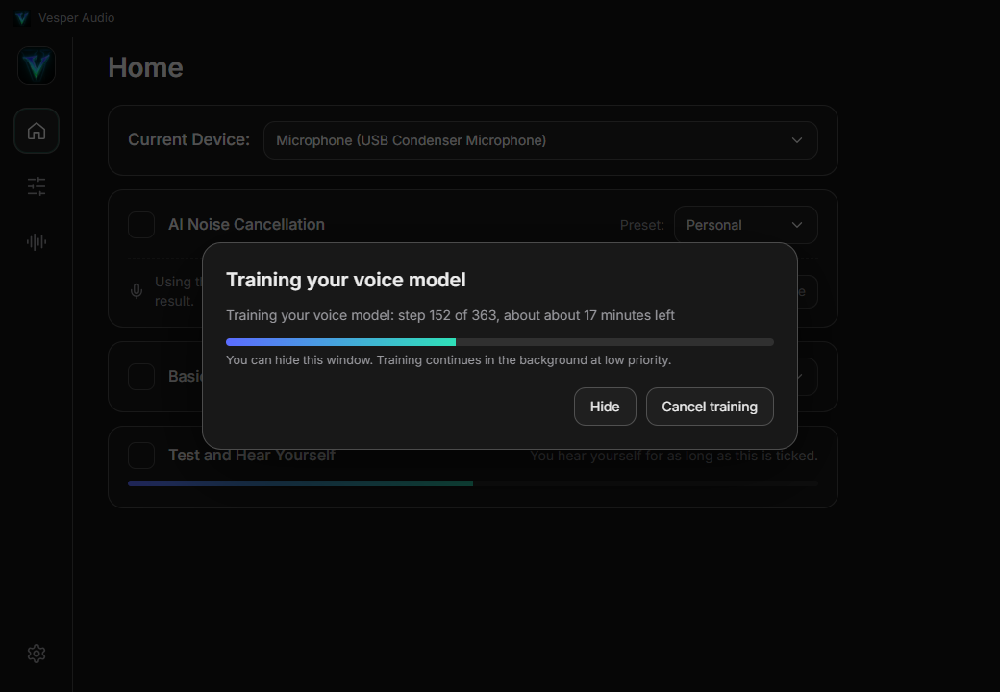
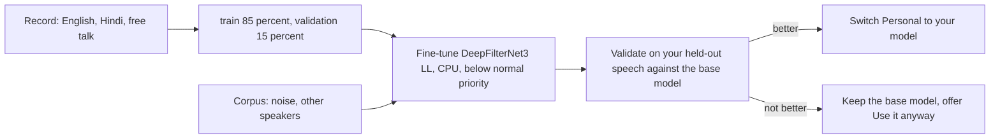
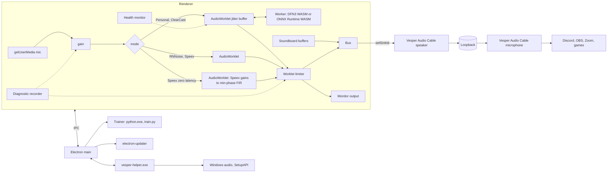

<p align="center">
  
</p>

<h1 align="center">Vesper Audio</h1>

<p align="center">
  A virtual microphone for Windows with local AI noise cancellation that you can fine-tune on your own voice, a zero latency basic mode, and a soundboard.<br>
  Your mic goes in, a clean signal comes out of <b>Vesper Audio Cable</b>. Nothing leaves your PC.
</p>

<p align="center">
  <a href="https://github.com/AroseEditor/Vesper-Audio/releases/latest"></a>
  
  
  
  
  
</p>

```
mic -> gain -> noise cancelling -> limiter -> Vesper Audio Cable -> Discord / OBS / Zoom / games
               Personal (your own model)  ^
               ClearCast                  soundboard (local MP3s)
               Basic: Speex, Speex zero latency, RNNoise
```

---

## Contents

1. [What's new in 1.2.0](#whats-new-in-120)
2. [What it is](#what-it-is)
3. [Screens](#screens)
4. [Install and updates](#install-and-updates)
5. [Quick start](#quick-start)
6. [Features](#features)
7. [Noise cancellation modes](#noise-cancellation-modes)
8. [Train your voice model](#train-your-voice-model)
9. [Latency](#latency)
10. [Reliable audio and diagnostics](#reliable-audio-and-diagnostics)
11. [Vesper Audio Cable](#vesper-audio-cable)
12. [Real Windows properties](#real-windows-properties)
13. [Benchmarks](#benchmarks)
14. [Architecture](#architecture)
15. [Build from source](#build-from-source)
16. [CI and releases](#ci-and-releases)
17. [Data and privacy](#data-and-privacy)
18. [Troubleshooting](#troubleshooting)
19. [Honest limits](#honest-limits)
20. [Repository layout](#repository-layout)
21. [Licenses and credits](#licenses-and-credits)

---

## What's new in 1.2.0

Version 1.2.0 replaces the voice lock. Every item below answers a complaint about 1.1.0.

| Complaint about 1.1.0 | What changed |
| --- | --- |
| Custom and Custom Heavy cut my voice, leak other voices and flicker | **Removed**, together with the speaker-verification gate behind them. A gate that decides "is this you" has to guess, and every wrong guess is a cut or a leak. |
| I want a model trained on my own voice, in Hindi and English | **Personal** preset. [Train your voice model](#train-your-voice-model) fine-tunes DeepFilterNet3 (low latency variant) on your recordings, on your PC. English and Hindi tick boxes, both on by default. Light is about 30 minutes of training, Heavy about 2 hours. |
| ClearCast sounds best but lets background noise through | Strength now defaults to 100 percent (it was 80, which leaves a noise floor of about -36 dB). |
| Everything cuts and flickers while SteelSeries is smooth | The limiter was a Web Audio compressor (-2 dB threshold, 20:1). It is now a small worklet limiter with no lookahead and a 150 ms release. The jitter buffer floor dropped from 2 hops to 1 and the prebuffer from 3 to 2. Not verified on your microphone: I could not reproduce the cutting on this PC. The new [diagnostic recorder](#reliable-audio-and-diagnostics) exists to capture it on yours. |
| I want 0 ms | **Speex zero latency** (Basic) measured 0 ms. The neural models cannot reach 0 ms, see [Latency](#latency): Personal is 42 to 53 ms, the lowest a neural model gets here, and it is the default. |
| Hear Yourself added delay | With Test and Hear Yourself on, the audio engine now outputs straight to your headphones and the cable gets its own stream. With it off, the engine outputs straight to the cable. Monitor latency itself is not measured. |
| Hard to report what goes wrong | **Settings, Record diagnostic** saves 30 seconds of raw microphone, processed audio and a stats file to Documents. |

Updating from 1.1.0 keeps your settings and sounds. Custom and Heavy become Personal. Voiceprints and voice recordings from 1.1.0 are not used any more.

---

## What it is

| Part | What it does |
| --- | --- |
| **Vesper Audio** (Electron app) | Captures your real microphone, cleans it, mixes in the soundboard and plays the result into the virtual cable. Lives in the system tray. |
| **Vesper Audio Cable** (virtual microphone) | A virtual speaker and a virtual microphone joined by a loopback. Anything written to the speaker comes out of the microphone, and other apps pick the microphone. It runs on the Microsoft-signed [VB-CABLE](https://vb-audio.com/Cable/) driver, renamed and given the Vesper icon, so Secure Boot stays on. A self-signed Vesper driver is kept as an advanced fallback. |
| **vesper-helper.exe** (Rust) | Talks to Windows: lists endpoints, reads and writes the real Sound control panel properties, renames and re-icons the cable, verifies driver signatures, installs and removes drivers. |
| **Trainer package** | Optional 233 MB download (embeddable Python, PyTorch CPU, training scripts, small corpus). Only fetched when you press **Train my voice**. |
| **AI models** | DeepFilterNet3 low latency (Personal), DPDFNet baseline (ClearCast), RNNoise and Speex (Basic). Executed locally. |

---

## Screens

<table>
  <tr>
    <td><br><sub>Home: device, AI noise cancellation, basic noise cancellation, hear yourself</sub></td>
    <td><br><sub>Presets with their measured delay</sub></td>
  </tr>
  <tr>
    <td><br><sub>Train your voice model: English and Hindi tick boxes, Light or Heavy</sub></td>
    <td><br><sub>Recording: words light up as you read, seven steps for English plus Hindi</sub></td>
  </tr>
  <tr>
    <td><br><sub>Training runs in the background at low priority</sub></td>
    <td><br><sub>The result is checked against the base model before it is switched on (numbers shown are from the stand-in speaker test, not a real user)</sub></td>
  </tr>
  <tr>
    <td><br><sub>Settings: diagnostics, updates, drivers, train my voice, routing</sub></td>
    <td><br><sub>Properties: live Windows control panel values</sub></td>
  </tr>
  <tr>
    <td><br><sub>Sound-Board: up to 40 local MP3s</sub></td>
    <td><br><sub>Install Vesper Audio Cable on the Microsoft-signed VB-CABLE driver</sub></td>
  </tr>
</table>

---

## Install and updates

Download from the [latest release](https://github.com/AroseEditor/Vesper-Audio/releases/latest):

| File | Use |
| --- | --- |
| `Vesper-Audio-Setup-<version>.exe` | NSIS installer. Per-user, no admin needed for the app itself. Updates itself. |
| `Vesper-Audio-<version>-portable.exe` | Single file, no install. Tells you when a newer release exists. |
| `latest.yml`, `*.blockmap` | Update metadata read by the installer build. |
| `VesperAudioCable-x64.zip` + `.sha256`, `VesperAudioCable.cer` | The fallback driver package. Only used when VB-CABLE cannot be installed. |

Requirements: Windows 10 1903+ or Windows 11, x64, a microphone. Training needs the current Microsoft Visual C++ Redistributable (most PCs have it, the app tells you when not) and about 1.5 GB of free disk.

The executables are not Authenticode signed, so SmartScreen may warn on first launch.

**Updates.** The installer build checks GitHub 20 seconds after launch and every 6 hours, downloads a newer version in the background (hash checked against `latest.yml`) and shows **Restart to update**. The portable build cannot replace itself, so it shows **Download**. **Settings, Updates** has a manual check. The first real test of the updater is 1.1.0 to 1.2.0.

---

## Quick start

1. Run the app. First launch offers to install **Vesper Audio Cable**. The app downloads VB-CABLE from vb-audio.com, checks its SHA-256 and Microsoft signature, asks Windows for permission and opens the VB-Audio installer. Press **Install Driver** there. The app then renames the devices to Vesper Audio Cable. Secure Boot and Test Mode are not touched.
2. On **Home** pick your microphone and tick **AI Noise Cancellation**. Personal works immediately with the built-in model.
3. In Discord, OBS, Zoom or a game choose **Vesper Audio Cable** as the microphone.
4. Tick **Test and Hear Yourself** to listen to what others hear.
5. For the best result press **Train my voice**, tick your languages, read the passages once (about 9 minutes), and let it train in the background.

Closing the window sends the app to the tray. Left click the tray icon to open it, right click for **Exit**.

---

## Features

| Area | Detail |
| --- | --- |
| Device detection | Active capture and render endpoints straight from Windows (`IMMDeviceEnumerator`), live refresh on plug and unplug. |
| Properties | Format (rate, bits, channels), Levels, Listen to this device, Audio enhancements. All read and written on the real endpoint. |
| Custom Audio Gain | 0 to 400 percent software gain per microphone, saved per device. |
| AI Noise Cancellation | Presets **Personal** and **ClearCast**. |
| Basic Noise Cancellation | **Speex** (low CPU usage, low quality), **Speex zero latency** (0 ms) and **RNNoise** (good quality, more CPU usage). Speex and RNNoise follow OBS Studio's `noise-suppress-filter.c`: 10 ms frames (480 samples at 48 kHz), Speex through `speex_preprocess_state_init` with `SPEEX_PREPROCESS_SET_NOISE_SUPPRESS` set to the slider dB (-60 strongest to 0, default -30), RNNoise on 480-sample frames scaled by 32768, no makeup gain. Cannot be ticked while AI is on. |
| Train my voice | English and Hindi tick boxes, guided recording, background training, automatic validation. |
| Test and Hear Yourself | Plays the processed microphone to your chosen output for as long as it is ticked. |
| Soundboard | Local MP3 files, maximum 40. Played through the virtual microphone and your headphones, mixed with your voice. |
| Record diagnostic | 30 seconds of raw microphone, processed audio and stats, saved to Documents. |
| Settings | Open at login (hidden to tray), close to tray, updates, re-init or uninstall the driver, fallback driver, choose cable and monitor outputs, open repo. |
| Persistence | Everything is saved to `settings.json` and restored on start. |

---

## Noise cancellation modes

| Mode | Engine | Delay (measured) | Notes |
| --- | --- | --- | --- |
| **Personal** (AI default) | DeepFilterNet3 low latency, 48 kHz, no lookahead, 36 MB. Built-in until you train it, then your fine-tuned copy. | 42 to 53 ms | A soft mask, never a gate: it cannot go silent because a classifier hesitated. |
| **ClearCast** (AI) | DPDFNet baseline, 16 kHz, 8.7 MB. Strength slider 0 to 100 percent (default 100). | 81 to 91 ms | Studio style cleanup. Strengths below 100 let some background noise through on purpose. |
| **Speex zero latency** (Basic) | Speex runs on a side chain. Its per-band gains become a minimum-phase FIR filter applied to your live samples, with a fast override at the start of speech. | 0 ms | Slightly less precise at the start of words. |
| **Speex** (Basic) | OBS-identical Speex. | 13 to 23 ms | |
| **RNNoise** (Basic) | OBS-identical RNNoise. | 21 to 26 ms | |

Fallback: if the personal or ClearCast model cannot start, or the CPU cannot keep up for a sustained period, the app switches to the built-in DeepFilterNet3 without a gap in the audio and says so.

---

## Train your voice model

The idea: an unconditional denoiser has no idea who is talking. Fine-tuned on a few minutes of **your** speech, mixed with noise and with other people's speech that it is taught to treat as noise, it learns your voice, your room and your microphone. Nothing is sent anywhere. The model is a soft mask like the base model, so there is no gate, no lookahead and no added delay over the base model.



### Flow

1. **Settings, Train my voice** or the button under the AI preset. Tick **English**, **Hindi** or both (both are on by default), then **Light** or **Heavy**.
2. **Record.** Per language: a passage in your normal voice (90 s of speech), quietly (60 s) and louder (60 s). Then 120 s of free talk in whatever mix you use. Words light up as you read, only real speech counts toward the bar, you can pause, skip a step or finish after 4 minutes. About 9 minutes for both languages. The app warns about a noisy room or clipping.
3. **Download.** The first time, the 233 MB trainer package (embeddable Python, PyTorch CPU, scripts, corpus) is downloaded from the `trainer-v1` release, hash checked and unpacked under `%APPDATA%\Vesper Audio\trainer`.
4. **Train.** Python runs at below normal priority with 2 to 6 threads, so a game or a call keeps running. You can hide the window and keep working.
5. **Validate.** The result and the base model are scored on your held-out recordings (15 percent that never went into training). If your voice is cut more than the base model, or other voices are removed less, the base model stays and the dialog says why. **Use it anyway** overrides.
6. **Switch on.** The accepted model is stored as `models\personal-<id>.tar.gz` and loaded by the same WebAssembly runtime as the base model.

| | Light | Heavy |
| --- | --- | --- |
| Training time | about 30 minutes | about 2 hours |
| Download | 233 MB (once) | the same package |
| Base model | DeepFilterNet3 low latency | the same, trained for longer |
| Runs on | CPU | CPU |

Heavy is not a bigger network. No permissive, causal, low latency model above about 10 million parameters exists, so Heavy means more steps. CUDA PyTorch is 2.9 GB, so GPU training is not offered.

### What is trained

| Item | Value |
| --- | --- |
| Base | DeepFilterNet3 low latency (MIT or Apache-2.0), 9.7 million trainable parameters in three ONNX graphs. A custom ONNX graph executor in PyTorch (`training/onnxexec.py`) trains them directly and writes the weights back. |
| Runtime parity | The executor matches onnxruntime to about 1e-6, and a re-saved model loads bit-identically in the WebAssembly runtime. |
| Optimiser | AdamW, learning rate 5e-5 with warmup and cosine decay, gradient clip 1.0, batch of 12 clips of 1.5 s. About 4 s per step on an i7-12650H. |
| Mixing | On the fly: your speech at a level from -18 to +3 dB, plus DEMAND or synthetic noise (coloured noise, hum, mic pops) at -5 to 30 dB SNR. 30 percent of clips have a silent target, 75 percent also get another speaker at -5 to 15 dB. Room reverb is applied to the interferers, never to your target. |
| Losses | Multi-resolution STFT (gamma 0.3), over-attenuation penalty, cut penalty on frames where your voice drops, leak penalty on frames that must be silent, local SNR head. |
| Corpus (233 MB package) | 18 DEMAND noise recordings (CC BY 4.0), 120 LibriSpeech dev-clean clips (CC BY 4.0), 150 OpenSLR SLR104 Hindi-English clips (CC BY-SA 4.0). ESC-50 and WHAM were left out because they are non-commercial. |

### Measured

One speaker, LibriSpeech 1272, as a stand-in for a user: 393 s of speech for training, held-out clips for the test, 360 steps (about 25 minutes). "Cut" is the share of your speech frames where the output is more than 3 dB below the clean reference. Lower is better for cut and higher is better for dB.

| Test | Base model | After training |
| --- | --- | --- |
| Clean speech, cut | 2.2% | **0.7%** |
| Speech with noise at 10 dB, cut | 13.3% | **9.1%** |
| Speech with noise at 0 dB, cut | 24.7% | **17.7%** |
| Speech with another speaker at 5 dB, cut | 37.3% | **8.6%** |
| Speech with another speaker at 0 dB, cut | 34.1% | **12.3%** |
| Quiet speech, cut | 10.0% | **7.8%** |
| Other speakers alone, reduction | 0.2 dB | **5.6 dB** |
| Noise alone, reduction | 66.5 dB | **74.1 dB** |

The gain is mostly that **your voice survives when someone else talks or the room is noisy**. Other voices are reduced by 5.6 dB when they are alone, which is far from a lock. The recipe is a deliberate balance: an earlier run that removed other voices harder (about 7 dB) cut the target more, and one that cut the target least removed others by only 1 dB.

This test used one English speaker. Hindi and a real user's own voice have not been measured. The app runs the same comparison on your own held-out recordings and shows you the numbers.

---

## Latency

Measured in the repository harness: a speech clip is injected before the denoiser and the output envelope is cross-correlated with the input envelope, 3 runs per mode on an i7-12650H with a quiet CPU. The harness has an error of about 10 ms, so read these as ranges.

| Path | Mic to cable output |
| --- | --- |
| Pass-through (no cancelling) | 0 to 3 ms |
| **Speex zero latency** | **0 ms** (one run read 13 ms) |
| Speex | 13 to 23 ms |
| RNNoise | 21 to 26 ms |
| **Personal** | **42 to 53 ms** |
| ClearCast | 81 to 91 ms |

The numbers exclude the sound card. Windows reports about 42 ms of output latency on this PC's speakers, and an input buffer on top. They exclude the monitor path, which was changed in 1.2.0 and not measured.

**Why Personal is not 0 ms.** DeepFilterNet3 works on 20 ms windows with a 10 ms hop. The low latency variant has no lookahead frames, so the algorithmic delay is about 30 ms (one window plus one hop) and the rest is the hop-aligned buffer between the worker and the audio thread, which is the price of not dropping audio. A neural model with this kind of analysis cannot be 0 ms. If you want none, use **Speex zero latency**.

---

## Reliable audio and diagnostics

A noise canceller that glitches is worse than none, so the audio path is built to survive a busy PC.

| Measure | What it does |
| --- | --- |
| Adaptive jitter buffer | The denoiser worker hands 10 ms blocks to the audio thread. The buffer starts at 20 ms and a late block grows it (up to 90 ms) instead of dropping audio, then it shrinks back during quiet. Underruns and refills are faded, never hard zeros. |
| No allocation on the audio thread | Blocks are recycled through a pool, so garbage collection cannot stall the audio callback. |
| Worklet limiter | Ceiling at 0.92, hard clip at 0.98, 150 ms release, no lookahead. |
| High process priority | The app and its renderer, GPU and audio processes run at High priority (`os.setPriority`, no admin needed). |
| No background throttling | Renderer backgrounding, timer throttling and occlusion tracking are off, and `prevent-app-suspension` is held, so a window hidden in the tray keeps full speed. |
| Dither | A signal at -110 dBFS is added in front of the denoiser so long digital silence cannot push its filters into slow denormal numbers. |
| Seamless swaps | Changing preset or falling back to the built-in model builds the new chain first and removes the old one after 90 ms. |
| Self healing | Checked every 2 s: audio context suspended, microphone track ended, microphone frozen on digital silence for 30 s, denoise worker no longer delivering audio, worklet processor error, worker crash. Also on Windows wake and unlock, and when audio devices change. |

Verified failures (scratch harness): killing the denoise worker is detected and restarted in about 6 s, a suspended audio context resumes immediately, a stopped microphone track is reconnected in about 4 s. Under 20 busy threads on this PC the 1.1.0 buffer gave 0 dropouts on the AI presets (1.0.0 gave 32 in 15 s).

**Record diagnostic** (Settings): captures 30 seconds of the raw microphone, the processed output and a JSON file with the mode, model, buffer statistics and engine latency, into `Documents\Vesper Audio Diagnostics`. If your voice still cuts, send these three files. They show whether the cut is in the microphone, in the model or in the audio path.

---

## Vesper Audio Cable

### Default: VB-CABLE, signed by Microsoft

| Property | Value |
| --- | --- |
| Driver | VB-CABLE Driver Pack 45 by VB-Audio Software, donationware, [vb-cable.com](https://vb-audio.com/Cable/) |
| Signature | catalog and `.sys` signed by `Microsoft Windows Hardware Compatibility Publisher`, so it loads with Secure Boot on and without Test Mode |
| Hardware ID | `VBAudioVACWDM` |
| Source | `https://download.vb-audio.com/Download_CABLE/VBCABLE_Driver_Pack45.zip`, pinned SHA-256 `b950e39f01af1d04ea623c8f6d8eb9b6ea5c477c637295fabf20631c85116bfb` |
| Checks | the hash must match, then `Get-AuthenticodeSignature` on the catalog must report a valid Microsoft signature, otherwise nothing is run |
| Install | the app launches the official `VBCABLE_Setup_x64.exe` with administrator approval and VB-Audio's own window and licence. You press **Install Driver** |
| Branding | the helper rewrites the endpoint properties in the Windows property store (device name, adapter name, friendly name, icon) to **Vesper Audio Cable (Vesper Audio)** with the Vesper icon. The driver package is never modified. Endpoints that still say VB-Audio are finished on the next launch |

Why the install is not silent and the package is not in this repository: the VB-CABLE licence allows copying the package as is, and does not allow integrating it into another software's installation procedure without the author's agreement. The app therefore downloads the official package, shows VB-Audio's installer, and leaves the licence acceptance to you. Device Manager and the Apps list still show VB-Audio because the signed package cannot be edited without breaking its signature. If you use the cable, please [donate to VB-Audio](https://vb-audio.com/Cable/).

| State | App behavior |
| --- | --- |
| Endpoints present | Nothing to do, no banner. |
| Cable devices named `CABLE Input`, `CABLE Output` or still carrying VB-Audio | Renamed to Vesper Audio Cable with the Vesper icon (only when Vesper installed the cable). |
| VB-Audio installer closed, devices not there yet | Offers a 15 second restart you can cancel. |
| Driver installed but no endpoints | Banner **Repair** runs setup again. |

### Fallback: the Vesper driver

For the rare PC where VB-CABLE cannot be used. **Settings, Fallback driver** or **Use fallback driver** in the install window. A fork of [VirtualDrivers/Virtual-Audio-Driver](https://github.com/VirtualDrivers/Virtual-Audio-Driver) (MIT, derived from Microsoft's SysVAD sample), renamed and extended with a loopback.

| Property | Value |
| --- | --- |
| Hardware ID | `ROOT\VesperAudioCable` |
| Format | fixed 48 kHz, 16-bit PCM, stereo on both endpoints (so the ring never converts) |
| Loopback | render stream `ReadBytes` writes into a 256 KB spin-locked ring, capture stream `WriteBytes` reads from it |
| Latency | primes at 20 ms, trims to 20 ms above 120 ms, discards when nobody is recording for 500 ms |
| Package | `.sys` (about 64 KB), `.inf`, `.cat`, `.cer`, built on GitHub Actions with the WDK |

There is no Microsoft attestation signature for it. It is signed with one shared self-signed certificate (subject `CN=Vesper Audio, O=Vesper Audio`, thumbprint `8F4206F58271F2A11BD13C374636B122569AA265`, private key only in the GitHub Actions secrets `VAC_SIGN_PFX` and `VAC_SIGN_PASSWORD`). The installer imports the public certificate into **Trusted Root** and **Trusted Publishers**. Windows loads a driver that Microsoft did not sign only in **Test Mode**, and Test Mode needs **Secure Boot** off, so this path alone needs firmware changes:

| State | App behavior |
| --- | --- |
| Secure Boot on, Test Mode off | Dialog with the exact steps: Settings, System, Recovery, Advanced startup, Restart now, Troubleshoot, Advanced options, UEFI Firmware Settings, set Secure Boot to Disabled, then Install again. Button to open the recovery page and a recheck button. |
| Test Mode just switched on | Install succeeded, restart required. |
| Device present with a problem code | Shows the code and next steps. |


Kernel anti-cheat games (Vanguard, FACEIT and similar) may refuse to run while Secure Boot is off. **Settings** has Uninstall for either driver.

---

## Real Windows properties

| Control | Mechanism |
| --- | --- |
| Format, channels | `PKEY_AudioEngine_DeviceFormat` from the endpoint property store |
| Levels | `IAudioEndpointVolume` master scalar |
| Listen to this device | endpoint property `{24dbb0fc-9311-4b3d-9cf0-18ff155639d4},1` |
| Allow processing or bypass (audio enhancements) | undocumented `IPolicyConfig::SetPropertyValue` on the FX store, key `PKEY_AudioEndpoint_Disable_SysFx` `{1da5d803-d492-4edd-8c23-e0c0ffee7f0e},5` |
| Cable name and icon | `IPolicyConfig::SetPropertyValue` on the endpoint store: `{a45c254e-df1c-4efd-8020-67d146a850e0},2` and `,14`, `{b3f8fa53-0004-438e-9003-51a46e139bfc},6`, `{259abffc-50a7-47ce-af08-68c9a7d73366},12` (string values must be `VT_LPWSTR`) |

None of these need administrator rights. The Sound control panel and the app always agree because the app reads the same store and polls for changes.

---

## Benchmarks

Measured in this repository's own harness on one laptop (i7-12650H). Treat numbers as indicative, not universal.

<details>
<summary>Denoising quality of the shipped base models (DNSMOS P.835, higher is better)</summary>

6 public speech clips from 3 speakers (about 27 s) mixed at 5 dB SNR with 11 [ESC-50](https://github.com/karolpiczak/ESC-50) noise types: airplane, crying baby, door knock, engine, footsteps, keyboard, mouse click, rain, vacuum cleaner, washing machine, wind. Scored with Microsoft DNSMOS (calibrated polyfit) at 16 kHz. This was measured in 1.0.0 and has not been repeated for the low latency variant.

| Processing | SIG | BAK | OVRL |
| --- | --- | --- | --- |
| Noisy input | 3.04 | 2.02 | 2.06 |
| DeepFilterNet3 (full model) | 2.74 | 3.74 | 2.43 |
| **DPDFNet baseline 16 kHz (ClearCast)** | **3.31** | **4.02** | **3.00** |
| Clean speech reference | 3.48 | 3.48 | 2.91 |
</details>

<details>
<summary>Cost per 10 ms frame</summary>

| Model | Device | Time |
| --- | --- | --- |
| DeepFilterNet3 | CPU, WASM SIMD, Node | 1.5 ms |
| DPDFNet baseline | CPU, WASM, in the app | 1.1 ms |

Streaming frames are latency bound, not throughput bound, so a GPU does not help a denoiser.
</details>

### Training speed

| Step | Time on an i7-12650H (6 threads, below normal priority) |
| --- | --- |
| One training step (batch 12, 1.5 s clips) | 3.3 to 5.4 s |
| 360 steps (the Light budget in the test above) | about 25 minutes |
| Trainer package download | about 40 s on a fast line |
| Validation on 16 held-out clips | about 1 minute |

### Test suites

* `npm test` runs 15 checks against a synthetic noise file: boot, pages, Windows endpoints, noise reduction per mode (RNNoise, Speex, Speex zero latency, Personal, ClearCast), soundboard, close to tray, persistence, and a start check of the built-in personal model.
* A 57 check UI audit drives every button, dropdown, slider and dialog, including the training dialog and real writes to the Windows volume, Listen and Enhancements properties (restored afterwards). On a PC that already has the cable installed, the first-run dialog and driver banner checks do not apply and are expected to fail.
* An end to end run of the in-app flow (save recordings, download the trainer from GitHub, train, validate, load the model) passed with a short training schedule.

---

## Architecture



* The audio engine lives in the renderer. Background throttling, renderer backgrounding and occlusion tracking are off, so it keeps running while the window is hidden in the tray.
* Denoisers run in a Worker connected to an AudioWorklet by a `MessageChannel`. The worklet owns an adaptive jitter buffer. A watchdog drops to the built-in model if the worker falls behind, and swaps without a gap.
* With Test and Hear Yourself off, the audio context outputs directly to the cable. With it on, the context outputs to the monitor device and the cable is fed by a second stream.
* The trainer is an ordinary child process. The app only sends it paths and reads JSON lines (`loaded`, `plan`, `step`, `done`) from its output. Cancel kills the process tree.
* Models are fetched on demand with SHA-256 verification and stored under `models/`.

---

## Build from source

Prerequisites: Node 22, Rust stable, `rustup target add wasm32-unknown-unknown`, `cargo install wasm-bindgen-cli --version 0.2.92 --locked`.

```powershell
npm ci
npm run build:df
npm run helper
npm start
npm test
npm run dist
```

| Script | Does |
| --- | --- |
| `build:df` | Clones DeepFilterNet at a pinned commit, builds its WASM with SIMD, downloads and checks the full and the low latency model. |
| `helper` | Builds `vesper-helper.exe` with Cargo. |
| `start` | Runs the app. In this repo's shell `ELECTRON_RUN_AS_NODE` must be unset. |
| `test` | Launches the real app with a fake audio device and checks behavior. |
| `dist` | NSIS installer, portable exe, `latest.yml` and blockmap into `dist/`. |

The trainer package is built with [`tools/build-trainer.py`](tools/build-trainer.py):

```powershell
python training/build_corpus.py --out build/corpus --demand <DEMAND zips> --libri <LibriSpeech dev-clean> --slr104 <SLR104 test set>
python tools/build-trainer.py --out build/trainer --corpus build/corpus
```

The first command downloads embeddable Python and the CPU PyTorch wheel, prunes headers and tests, copies `training/` and the corpus, zips the result and writes the SHA-256 file. `build_corpus.py` cuts the corpus excerpts from the original DEMAND, LibriSpeech and SLR104 downloads.

Running the trainer by hand:

```powershell
python training/train.py --base DeepFilterNet3_ll_onnx.tar.gz --clean my_recordings --noise corpus/noise --speech corpus/speech --out personal.tar.gz --steps 360
python training/evaluate.py --model personal.tar.gz --clean my_held_out --noise corpus/noise --speech corpus/speech
```

The fallback driver needs the Windows Driver Kit and Visual Studio 2022. It is built by CI (`windows-2022`), not locally.

---

## CI and releases

`.github/workflows/release.yml` builds everything and attaches it to one release.

| Job | Output |
| --- | --- |
| `driver` | WDK build, sign `.sys`, regenerate and sign `.cat`, zip with the certificate, SHA-256 file |
| `app` | DeepFilterNet WASM, Rust helper, NSIS installer, portable exe, update metadata |
| `publish` | One GitHub release with all assets |

```powershell
git tag v1.2.0
git push origin v1.2.0
```

The installer build finds updates through the release's `latest.yml`, so every release must carry it (the workflow uploads it). Manual runs (`workflow_dispatch`) take `target` (`all`, `driver`, `app`) and `publish` (default false), so a build can be checked without releasing.

Two pre-releases hold large files that the app downloads: `models-v1` (the quantized speaker model from 1.1.0) and `trainer-v1` (`VesperTrainer-win-x64.zip` and its `.sha256`). Both are marked pre-release so the updater's "latest" lookup never picks them up. The app pins the tag and the asset name, so a new trainer package needs a new tag (`trainer-v2`) and a new `PACK_VERSION` in `src/trainer.js`.

---

## Data and privacy

Everything runs on your PC. The only network traffic is downloads: the VB-CABLE package from vb-audio.com, the fallback driver, the trainer package, models, and release lookups for updates. No telemetry. Your recordings never leave the machine.

| Path (`%APPDATA%\Vesper Audio`) | Content |
| --- | --- |
| `settings.json` | All settings and which personal model is active |
| `voice/train`, `voice/val` | Your recordings (48 kHz 16-bit WAV), 85 percent for training, 15 percent for validation. Wiped when you record again |
| `models/personal-<id>.tar.gz` | Your trained model. Remove it with **Retrain**, or delete the file |
| `trainer/pack` | Unpacked trainer package (about 530 MB) |
| `sounds/` | Copies of your soundboard files |
| `models/` | Downloaded models |

`Documents\Vesper Audio Diagnostics` holds diagnostic recordings you made yourself. `C:\ProgramData\Vesper Audio\vesper.ico` holds the cable icon. Delete `voice/`, `trainer/` and the `personal-*` files to forget your voice.

---

## Troubleshooting

| Symptom | Cause and fix |
| --- | --- |
| Vesper Audio Cable not in other apps | Check the banner on Home. Install not finished: press **Install**. Restart needed: press **Restart**. |
| Cable still says VB-Audio | Restart the app. Branding finishes on launch for a cable that Vesper installed. |
| Fallback driver, problem code 52 | Windows rejected the self-signed driver. Test Mode must be on and Secure Boot off, or use the default VB-CABLE driver. |
| Banner says code 10, 31, 37 or 39 | Press **Fix**, or Settings, **Re-init and Setup**. |
| Other apps hear nothing | Pick **Vesper Audio Cable** as the microphone in that app, and check the Home level meter moves. |
| My voice is delayed | Personal is about 45 ms and ClearCast about 90 ms. Use **Basic Noise Cancellation, Speex zero latency** for none. |
| My voice cuts or flickers | Press **Record diagnostic** in Settings while it happens and send the three files. Then try Personal, or lower ClearCast strength. |
| It still lets other voices through | Personal reduces other voices by a few dB, it is not a lock. Record in the room you use, tick the languages you speak, and try **Heavy**. |
| Training says the result is not better | The check against your own held-out recordings failed. Record in a quieter room, or use **Use it anyway** if you prefer the result. |
| Training exits with code 3221225781 | Windows is missing the Microsoft Visual C++ Redistributable. Install the current x64 version and try again. |
| Trainer download fails | The package comes from GitHub (`trainer-v1`). Check the connection and try again. The download is hash checked, so a partial file is rejected. |
| A restart notice appears now and then | The health monitor fixed a stalled worker, a lost microphone or a wake from sleep. It is informational. |
| "Using the built-in model" | Your personal model or the ClearCast model could not start, or the CPU could not keep up. |
| Echo or feedback | **Test and Hear Yourself** is on with speakers. Use headphones or untick it. |
| Updates say "installed builds only" | You are running from source. Updates apply to the installer and portable builds. |

---

## Honest limits

* The base models are open source and were not trained by this project. What is this project's: the training pipeline (graph executor, losses, mixing, validation), the recording flow, the zero latency Speex, and the audio path.
* **Personal is not a voice lock.** On the stand-in speaker it removed other voices by 5.6 dB when they were alone. It mainly keeps your voice intact when others talk or the room is loud. If you need other voices gone, a noise gate will not do that reliably either, which was the lesson of 1.1.0.
* **The quality numbers come from one English speaker** (LibriSpeech 1272) used as a stand-in. Hindi and real user voices have not been measured. Each user gets their own numbers in the validation step.
* The corpus is small: 18 noise recordings and 270 speech clips. A model trained on it knows what DEMAND-like noise sounds like. Unusual noises will be handled by what the base model already knew.
* Heavy is two hours of the same recipe, not a bigger network. It was not benchmarked against Light.
* **Literal 0 ms is only reached by Speex zero latency.** The neural models measured 42 to 91 ms.
* The ClearCast cutting complaint was not reproduced on this PC. The changes to the limiter and buffers target what can plausibly cause it, and the diagnostic recorder is there to prove it on a real microphone.
* The monitor path was changed (direct output when Test and Hear Yourself is on) and its latency was not measured.
* The trainer package contains Python and PyTorch DLLs that are not signed by this project. Some antivirus products flag unknown Python runtimes in app data folders.
* The in-app updater has not been tested end to end. The first real test is 1.1.0 to 1.2.0.
* There is no Microsoft-signed Vesper driver. The default cable is VB-CABLE, signed by Microsoft and downloaded from VB-Audio. The Vesper kernel loopback compiles and is signed by CI with a self-signed certificate, and has not been exercised on the author's PC (Secure Boot on). Treat it as a fallback and report problems.
* The cause of "noise cancellation stops after the mic is idle" was not reproduced in tests with 120 s of silence or 7 minutes hidden. The self healing targets the plausible causes and was verified by breaking each one on purpose.
* Fixed 48 kHz 16-bit stereo on the fallback driver. Apps that force exclusive mode with another format cannot open it.

---

## Repository layout

```
.github/workflows/release.yml   build and release everything
driver/                         fallback WDM driver fork (Source/, Package/, certificate)
helper/                         Rust helper: audio endpoints, branding, driver install and checks
scripts/                        vendor.js, build-df.js, zero-speex.part.js, test.js
src/main.js, preload.js         Electron main process, tray, IPC, priority and power handling
src/trainer.js, wav.js          trainer download, training child process, validation, recordings
src/updater.js                  installer auto update and portable notice
src/driver.js, models.js        driver and model downloaders
src/ui/engine.js                audio graph, routing, health monitor, fallback swap
src/ui/denoise.worklet.js       adaptive jitter buffer
src/ui/limit.worklet.js         limiter
src/ui/record.worklet.js        raw capture for enrollment and diagnostics
src/ui/personal.js, diag.js     training dialog and diagnostic recorder
src/ui/denoise.worker.js        denoiser worker
training/                       onnxexec.py, dfn.py, data.py, losses.py, train.py, evaluate.py, build_corpus.py
tools/build-trainer.py          builds the trainer package
tools/quantize_weights.py       weight-only int8 for the 1.1.0 speaker model (not used by 1.2.0)
docs/                           screenshots
```

---

## Licenses and credits

This project: MIT (see [LICENSE](LICENSE)). Developed by Ayush.ue5.

| Component | License |
| --- | --- |
| Electron, ONNX Runtime, electron-updater | MIT |
| DeepFilterNet (base model and runtime) | MIT or Apache-2.0 |
| DPDFNet (Ceva-IP, ClearCast) | Apache-2.0 |
| PyTorch, NumPy, ONNX (trainer package) | BSD-3-Clause, BSD-3-Clause, Apache-2.0 |
| Python embeddable package | PSF License |
| @sapphi-red/web-noise-suppressor, RNNoise, SpeexDSP | MIT, BSD-3-Clause |
| Virtual-Audio-Driver (MikeTheTech) | MIT |
| VB-CABLE | VB-Audio Software, donationware, downloaded from vb-audio.com at install time and never redistributed here |
| Microsoft SysVAD sample | MS-PL |
| Inter font | OFL-1.1 |
| Lucide icons | ISC |

Data in the trainer package (`corpus/LICENSES.txt` has the same list):

| Data | License |
| --- | --- |
| DEMAND noise database (Thiemann, Ito, Vincent), Zenodo 1227121 | CC BY 4.0 |
| LibriSpeech dev-clean (Panayotov et al.) | CC BY 4.0 |
| OpenSLR SLR104 Hindi-English code-switching test set (MUCS 2021) | CC BY-SA 4.0 |

Microsoft DNSMOS and ESC-50 were used for benchmarking only and are not redistributed.

The files under `driver/Source` keep their original headers and notices as required by the upstream licenses.
