<p align="center">
  
</p>

<h1 align="center">Vesper Audio</h1>

<p align="center">
  A virtual microphone for Windows with local AI noise cancellation, a noise gate and loudness leveling, a soundboard, and an Android companion app that turns your phone into a <b>wireless microphone</b> or a <b>second monitor</b>.<br>
  Your mic goes in, a clean signal comes out of <b>Vesper Audio Cable</b>. Nothing leaves your own network.
</p>

<p align="center">
  <a href="https://github.com/AroseEditor/Vesper-Audio/releases/latest"></a>
  
  
  
  
  
  
</p>

```
                 +--> Personal / ClearCast / Basic noise cancelling --> gate --> loudness --> limiter -+
 PC microphone --+                                                                                     |
                 |                                                                                     v
 Phone microphone (Wi-Fi, encrypted) ------------------------------------------------------>  Vesper Audio Cable --> Discord, OBS, Zoom, games
                                                                                                        ^
 Soundboard (local MP3s) ---------------------------------------------------------------------------+

 PC screen --> H.264 (encrypted, Wi-Fi) --> Vesper Audio Connector on your phone = second monitor
```

---

## Contents

1. [What's new in 2.0.0](#whats-new-in-200)
2. [What it is](#what-it-is)
3. [Screens](#screens)
4. [Install and updates](#install-and-updates)
5. [Quick start](#quick-start)
6. [Vesper Audio Connector (Android)](#vesper-audio-connector-android)
7. [Phone microphone](#phone-microphone)
8. [Second monitor](#second-monitor)
9. [Vesper Link: pairing, security and the network](#vesper-link-pairing-security-and-the-network)
10. [Features](#features)
11. [Noise cancellation modes](#noise-cancellation-modes)
12. [Noise gate and loudness normalization](#noise-gate-and-loudness-normalization)
13. [Train your voice model](#train-your-voice-model)
14. [Latency and performance on low-end PCs](#latency-and-performance-on-low-end-pcs)
15. [Reliable audio and diagnostics](#reliable-audio-and-diagnostics)
16. [Vesper Audio Cable](#vesper-audio-cable)
17. [Real Windows properties](#real-windows-properties)
18. [Tests and benchmarks](#tests-and-benchmarks)
19. [Architecture](#architecture)
20. [Build from source](#build-from-source)
21. [CI and releases](#ci-and-releases)
22. [Data and privacy](#data-and-privacy)
23. [Troubleshooting](#troubleshooting)
24. [Honest limits](#honest-limits)
25. [Repository layout](#repository-layout)
26. [Licenses and credits](#licenses-and-credits)

---

## What's new in 2.0.0

Version 2.0.0 adds the phone, and trims the engine so it wastes less of a weak PC.

| New | What it does |
| --- | --- |
| **Vesper Audio Connector** (Android app) | Pair once with a QR code, then the phone finds the PC on its own. The phone always says **Connected to <your PC name>**, and you can **mute and unmute** the microphone from the app or from the notification. It is unmuted by default and stays unmuted until you mute it. |
| **Phone microphone** | Home has **+ Add phone mic**. The phone's microphone becomes the engine input, with every noise cancelling mode, the gate, the loudness leveler and the soundboard working on it. |
| **Second monitor** | A new **Second Monitor** page in the sidebar. The PC screen is captured, encoded as H.264 and sent to the phone. With the open source Virtual Display Driver installed the phone becomes a real extra monitor, without it the phone mirrors your main screen. |
| **Background and screen-off use** | The microphone runs in a foreground service with a wake lock, a Wi-Fi lock, automatic reconnection and a battery-optimization prompt. |
| **Download the app from the PC** | **Download Vesper Audio Connector** serves the signed APK over your own network with a QR code and a SHA-256, and it is also a release asset. |
| **Settings** | New rows for the phone link (with a Windows Firewall button), every paired phone (with Forget), and the virtual display driver (install and remove). |
| **Lighter on weak PCs** | The denoise worker drops stale frames instead of piling them up, meters run at 20 Hz and stop in the tray, the tray stops polling devices, only the renderer and audio processes get a small priority raise, the soundboard stream sleeps until used, and PCs with four cores or fewer get a steadier jitter buffer. See [Latency and performance](#latency-and-performance-on-low-end-pcs). |
| **No automatic switching** | Vesper Audio never changes your noise cancelling mode behind your back. The mode you pick is the mode that runs. |

Earlier releases: 1.3.0 added the [noise gate and loudness normalization](#noise-gate-and-loudness-normalization), 1.2.0 added the [personal voice model](#train-your-voice-model) and [Speex zero latency](#noise-cancellation-modes), 1.1.0 added the self-healing audio path.

---

## What it is

| Part | What it does |
| --- | --- |
| **Vesper Audio** (Electron app) | Captures your microphone (or a phone), cleans it, mixes in the soundboard and plays the result into the virtual cable. Lives in the system tray. |
| **vesper-core.exe** (Rust) | The link component. It listens for phones, pairs them, receives the phone microphone and drives the screen sender. The app starts it when needed and stops it on exit. |
| **vesper-display.exe** (Rust) | Captures a monitor, draws the mouse cursor, encodes H.264 with the Windows Media Foundation encoder and hands the frames to the link. It runs only while a screen is being shown. |
| **vesper-helper.exe** (Rust) | Talks to Windows: lists endpoints, reads and writes the real Sound control panel properties, brands the cable, installs drivers, adds the firewall rule. |
| **Vesper Audio Connector** (Android, Kotlin) | The phone side: QR scanner, discovery, secure link, microphone sender with mute, H.264 screen viewer. |
| **Vesper Audio Cable** | A virtual speaker and microphone pair. It runs on the Microsoft-signed [VB-CABLE](https://vb-audio.com/Cable/) driver, renamed and re-iconed, so Secure Boot stays on. A self-signed Vesper driver is the advanced fallback. |
| **Trainer package** | Optional 233 MB download used by **Train my voice**. |

---

## Screens

<table>
  <tr>
    <td>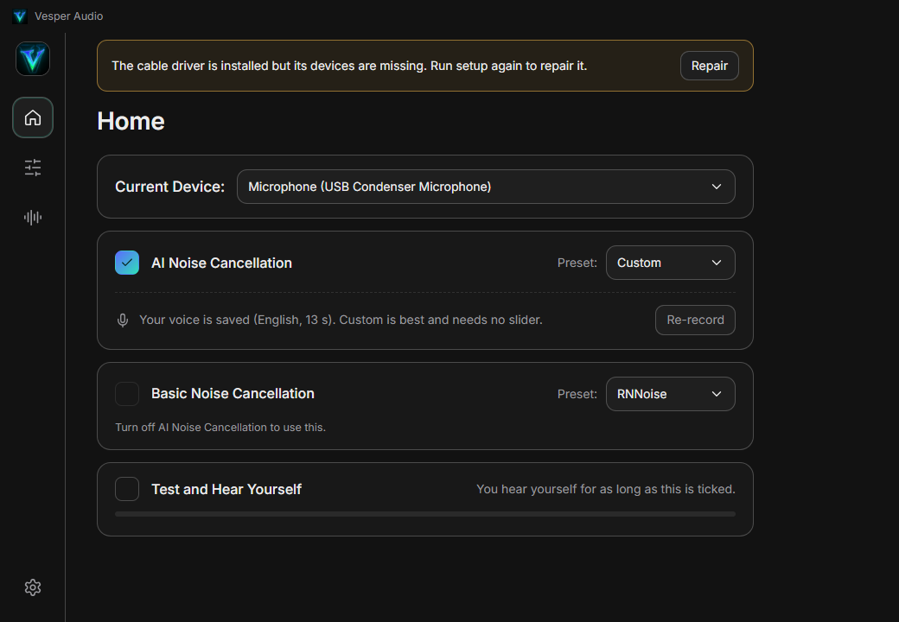<br><sub>Home: microphone (or phone), AI and basic noise cancelling, hear yourself, noise gate, loudness normalization, Add phone mic</sub></td>
    <td>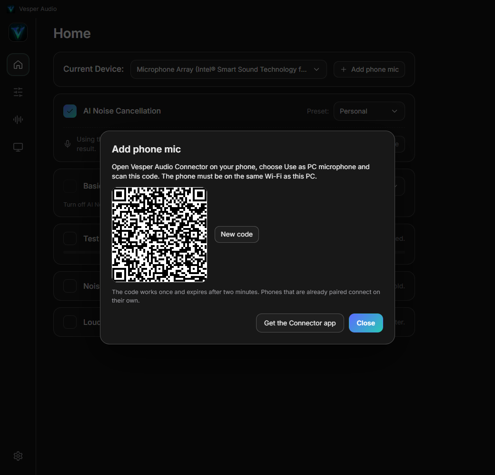<br><sub>Add phone mic: scan the code with the Connector app</sub></td>
  </tr>
  <tr>
    <td>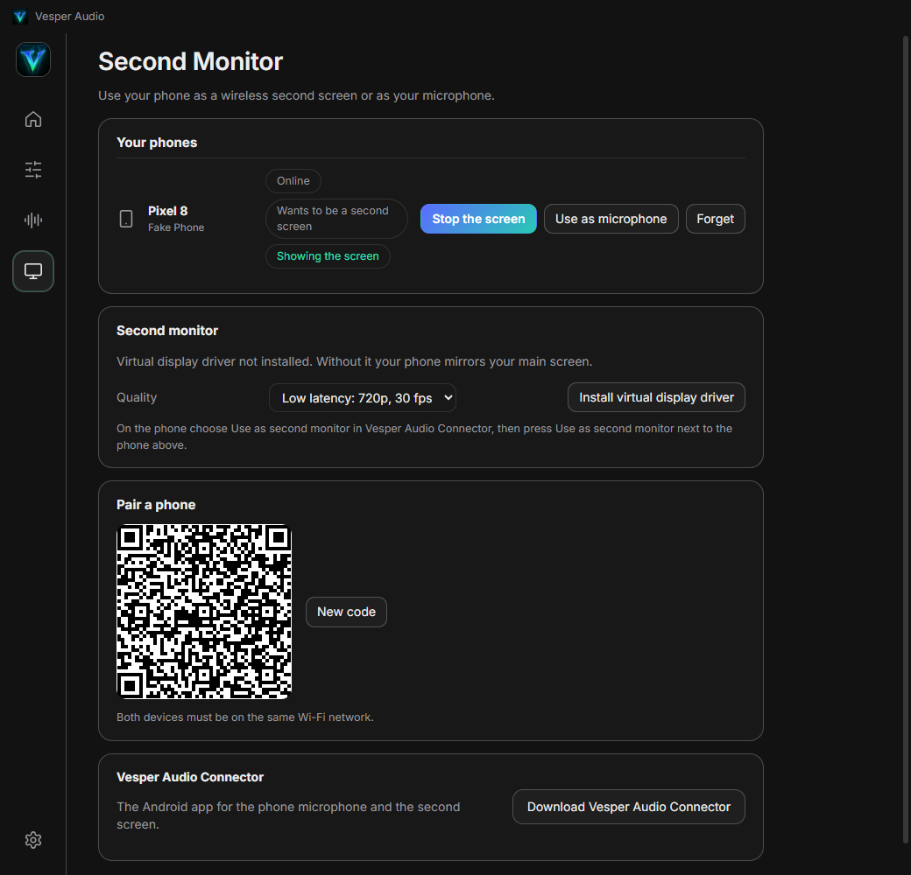<br><sub>Second Monitor: your phones, quality, virtual display driver, pairing code, app download</sub></td>
    <td>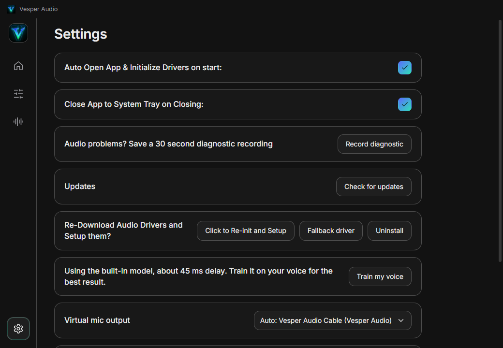<br><sub>Settings: diagnostics, updates, drivers, voice model, phone link, paired phones, virtual display driver</sub></td>
  </tr>
  <tr>
    <td>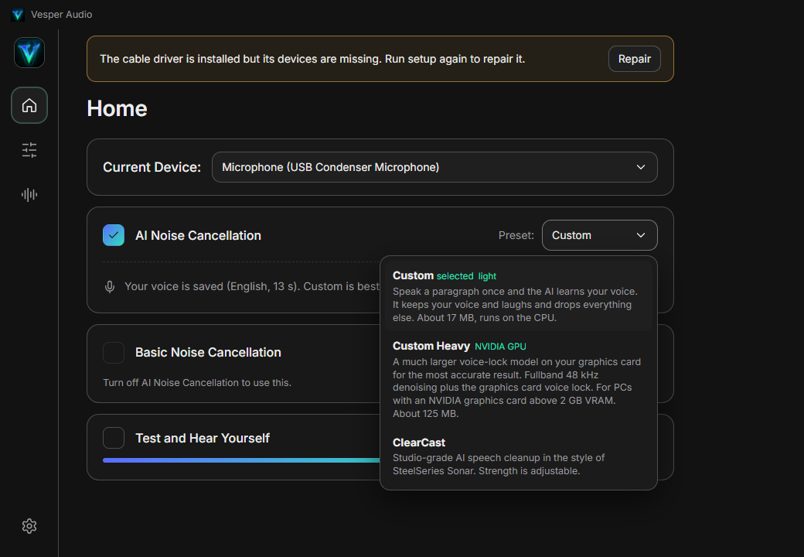<br><sub>AI presets with their measured delay</sub></td>
    <td>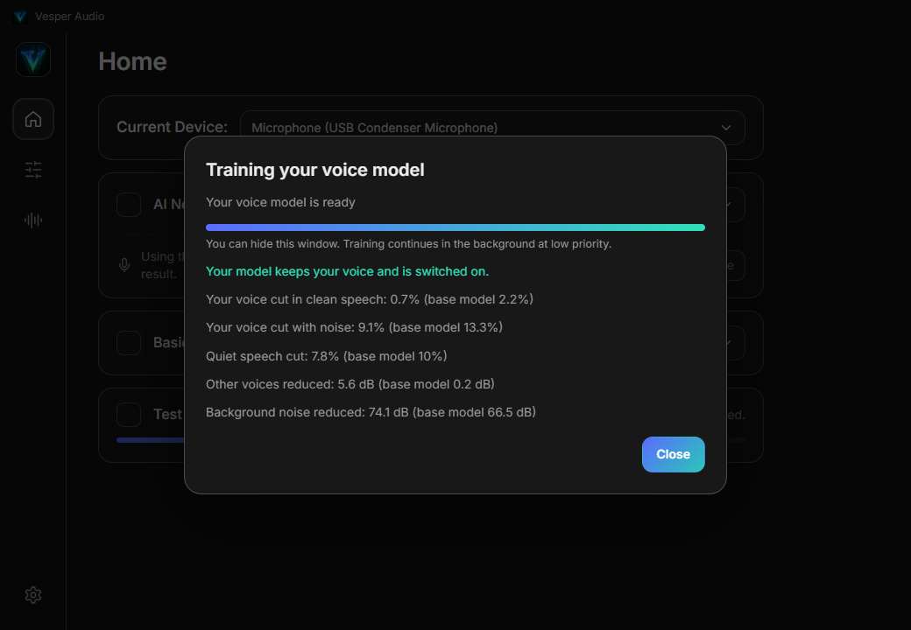<br><sub>Training result checked against the base model (stand-in speaker numbers)</sub></td>
  </tr>
  <tr>
    <td>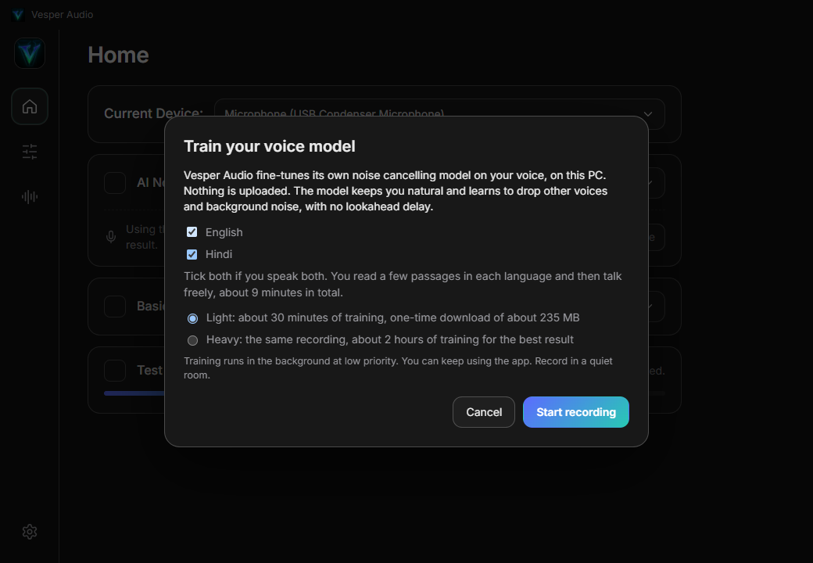<br><sub>Train your voice model: English and Hindi, Light or Heavy</sub></td>
    <td>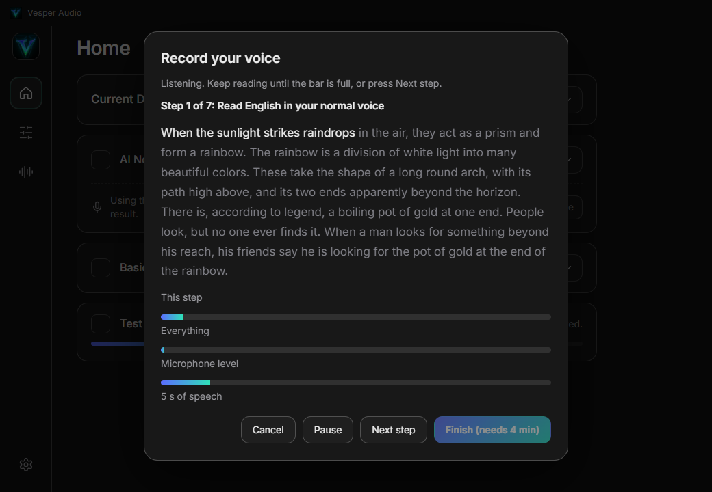<br><sub>Recording: words light up as you read</sub></td>
  </tr>
  <tr>
    <td>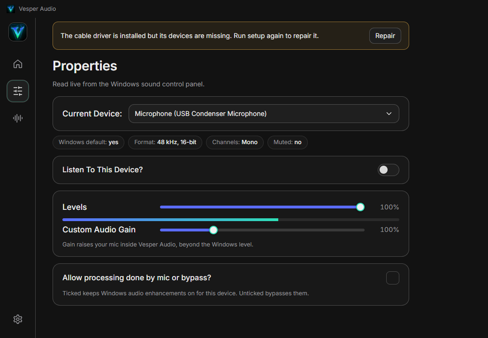<br><sub>Properties: live Windows control panel values</sub></td>
    <td>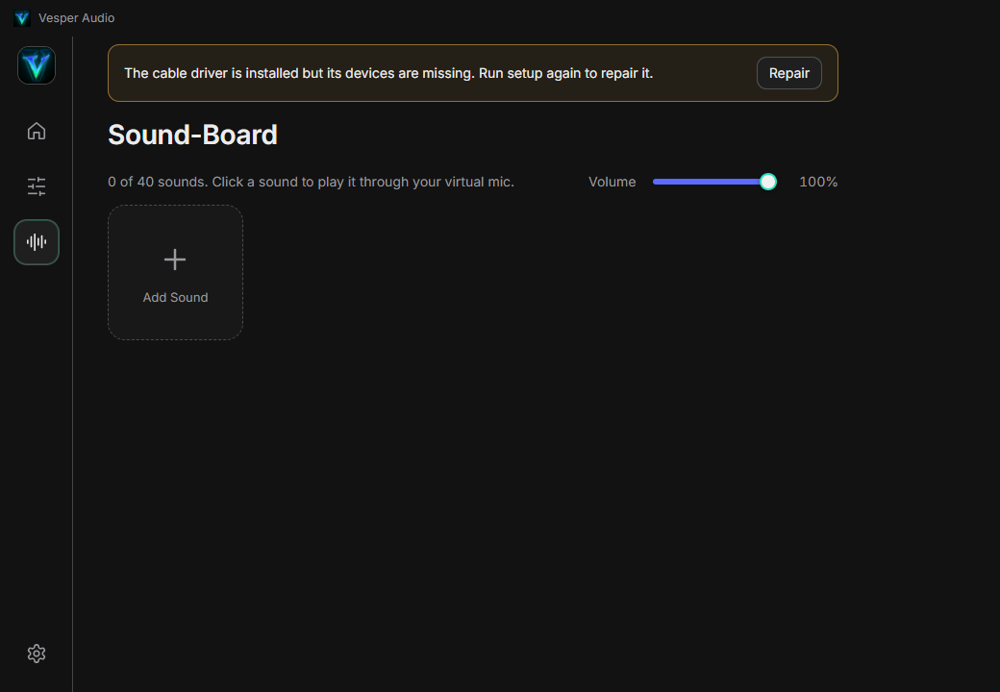<br><sub>Sound-Board: up to 40 local MP3s</sub></td>
  </tr>
</table>

There are no screenshots of the Android app because there is no Android device or emulator in the build environment. The app is described in words below.

---

## Install and updates

Download from the [latest release](https://github.com/AroseEditor/Vesper-Audio/releases/latest):

| File | Use |
| --- | --- |
| `Vesper-Audio-Setup-<version>.exe` | NSIS installer. Per-user, no admin needed for the app itself. Updates itself. |
| `Vesper-Audio-<version>-portable.exe` | Single file, no install. Tells you when a newer release exists. |
| `Vesper-Audio-Connector.apk` and `.sha256` | The Android app, signed. It is also inside the installer, so the PC can hand it to your phone. |
| `latest.yml`, `*.blockmap` | Update metadata read by the installer build. |
| `VesperAudioCable-x64.zip` + `.sha256`, `VesperAudioCable.cer` | The fallback driver package. Only used when VB-CABLE cannot be installed. |

Requirements: Windows 10 1903+ or Windows 11, x64, a microphone. For the phone features, an Android 10 or newer phone on the same Wi-Fi as the PC. Training needs the Microsoft Visual C++ Redistributable and about 1.5 GB of disk.

The executables are not Authenticode signed, so SmartScreen may warn on first launch.

**Updates.** The installer build checks GitHub 20 seconds after launch and every 6 hours, downloads a newer version in the background (hash checked against `latest.yml`) and shows **Restart to update**. The portable build cannot replace itself, so it shows **Download**. **Settings, Updates** has a manual check.

**Installing the Android app.** Either open the release page on the phone and download `Vesper-Audio-Connector.apk`, or on the PC press **Download Vesper Audio Connector** (Second Monitor page or Settings) and scan the code it shows. The phone downloads it straight from the PC over your own network. Android asks once to allow installs from your browser, and Play Protect may offer to scan the app because it is installed outside the Play Store.

---

## Quick start

On the PC:

1. Run the app. First launch offers to install **Vesper Audio Cable**. The app downloads VB-CABLE from vb-audio.com, checks its SHA-256 and Microsoft signature, asks Windows for permission and opens the VB-Audio installer. Press **Install Driver** there.
2. On **Home** pick your microphone and tick **AI Noise Cancellation** (or Basic Noise Cancellation).
3. In Discord, OBS, Zoom or a game choose **Vesper Audio Cable** as the microphone.
4. Tick **Test and Hear Yourself** to listen to what others hear.

Closing the window sends the app to the tray. Left click the tray icon to open it, right click for **Exit**.

To use your phone:

1. Install the Connector on your phone (see above).
2. On the PC press **+ Add phone mic** on Home, or open **Second Monitor** in the sidebar. A QR code appears.
3. On the phone open the Connector and press **Scan the QR code on your PC**. The phone shows **Connected to <your PC name>**.
4. Phone microphone: press **Use as PC microphone** on the phone. The PC selects the phone as its input.
5. Second monitor: on the phone press **Use as second monitor**, then on the PC press **Use as second monitor** next to the phone.

From then on the phone reconnects to the PC by itself whenever both are on the same Wi-Fi.

---

## Vesper Audio Connector (Android)

Requirements: Android 10 (API 29) or newer. The app is about 1.5 MB.

### Screen

| Element | Behavior |
| --- | --- |
| Status line | **Not connected to a PC**, **Paired with <PC>**, **Connecting to <PC>...**, **Reconnecting to <PC>...** or **Connected to <PC>**. The PC name is the Windows computer name. |
| Scan the QR code on your PC | Uses the Google code scanner (no camera permission needed). Scanning with the phone's camera app also works, the code opens the Connector directly. |
| Use as PC microphone | Asks for the microphone and notification permissions, starts the foreground service and sends your voice to the PC. |
| Mute microphone / Unmute microphone | Appears while the microphone is in use. **The microphone is on by default and stays on until you mute it.** While muted the phone sends nothing and the microphone is released, and the PC shows **Muted on phone**. The same toggle is in the notification. |
| Use as second monitor | Opens a full-screen landscape viewer. Start the screen from the PC. |
| PCs nearby | PCs found on the network. Choosing one pairs with a six-digit code that you compare on both screens. |
| Connect by address | Type `ip:port` of the PC for the same code pairing when discovery is blocked. |
| Keep running in the background | Opens Android's battery optimization prompt for the app. |
| Disconnect from the PC | Stops everything. |

### Background and screen off

* The microphone runs as an Android foreground service of type `microphone` with an ongoing notification (**Connected to <PC>**, **Microphone is on** or **muted**, actions **Mute** and **Stop**).
* A partial wake lock and a Wi-Fi lock keep the radio and the CPU awake while the screen is off.
* If Wi-Fi drops or the PC restarts, the app retries every 0.5 s growing to 10 s and finds the PC again by its fingerprint when its address changed.
* Android 14 and newer only allow a microphone foreground service to start while the app is visible, so start it from the app. It cannot be started from the background after a reboot.
* Many phones add their own battery savers on top of Android's. If audio stops with the screen off, allow background use in the app's battery settings. This was not tested on real phones, see [Honest limits](#honest-limits).

### Permissions

Microphone (to send your voice), notifications (for the foreground service), network, Wi-Fi state and multicast (to find the PC), wake lock, foreground service microphone, ignore battery optimizations (optional prompt). The app does not use the camera permission, location or contacts.

### Signing

The APK is signed with a release key whose certificate has this SHA-256 fingerprint:

`3D:8D:79:D2:AB:CD:89:D0:83:C1:20:F8:51:62:72:D8:96:92:D2:8E:93:5F:DA:BF:D4:AF:94:33:DF:EA:92:85`

Updates install over an existing copy only when signed with the same key. The key and its password live in the maintainer's private keys folder and in the repository's GitHub secrets, never in the repository.

---

## Phone microphone

**How it works.** The phone captures 48 kHz mono audio, cuts it into 10 ms frames of 480 samples, encrypts each frame and sends it over UDP to the PC. The link component decrypts, puts frames back in order and passes them to the app. A small AudioWorklet (`phone.worklet.js`) plays them into the same chain a real microphone uses, so noise cancelling, the gate, the loudness leveler, gain, the limiter, Test and Hear Yourself and the diagnostic recorder all work unchanged.

**Choosing it.** Home shows **+ Add phone mic**. Paired phones also appear in the device list as **Phone: <name>** with a tag (`connected`, `muted`, `offline`). When the selected phone is online and has asked to be a microphone, the PC starts the audio session on its own, so waking the phone or reconnecting just works.

| Behavior | Detail |
| --- | --- |
| Format | 48 kHz mono, 16-bit PCM, no compression. 768 kbit/s is nothing on Wi-Fi, and skipping a codec removes a few milliseconds and a native library on both sides. |
| Jitter buffer | Starts at 30 ms, grows by 5 ms after each underrun up to 120 ms, shrinks after about 10 seconds without one down to 20 ms. The read speed is nudged by up to 0.4 percent to follow the phone's clock without clicks. |
| Lost packets | Up to five missing frames are replaced by the last frame fading out. Late and duplicate packets are dropped. |
| Phone leaves | The output goes silent. It **never** falls back to the PC's own microphone. |
| Mute on the phone | The phone stops sending, the PC shows **Muted on phone** and plays silence without raising alarms. |
| Properties page | Windows level, Listen to this device and audio enhancements do not apply to a phone, so they are disabled for it. The software gain slider still works. |

Latency has not been measured on a real phone. The stages are the phone's capture buffer (device dependent, roughly 20 to 40 ms with the standard Android recorder), the network (a few milliseconds on a good 5 GHz Wi-Fi), the 30 ms jitter buffer and the noise cancelling mode you chose (see the [latency table](#latency-and-performance-on-low-end-pcs)). Use **Speex zero latency** or no noise cancelling for the shortest path. The microphone sender uses Android's `AudioRecord`, not the lower-latency Oboe library.

---

## Second monitor

**How it works.**

1. The PC captures a monitor with DXGI Desktop Duplication, draws the mouse cursor onto each frame, scales it to the chosen size and converts it to NV12.
2. The Windows Media Foundation H.264 encoder produces a baseline-profile stream in low-latency mode, constant bitrate, no B-frames, a keyframe every two seconds and on request.
3. Each frame is cut into slices of at most 1100 bytes, each slice is encrypted with AES-128-GCM and sent over UDP. The last 64 frames are kept so the phone can ask for missing slices again.
4. The phone reassembles frames in order and feeds them to Android's hardware H.264 decoder in low-latency mode, drawn straight to the screen. If something stays missing it asks for a keyframe.
5. Every 100 ms the phone reports packet loss. The PC lowers the bitrate by 30 percent when packets are lost and raises it by 5 percent per second when the link is clean, never above the chosen quality.

**Quality** (Second Monitor page):

| Preset | Size | Frame rate | Top bitrate |
| --- | --- | --- | --- |
| Low latency (default) | 1280 x 720 | 30 | 6 Mbit/s |
| Balanced | 1920 x 1080 | 30 | 12 Mbit/s |
| Smooth | 1920 x 1080 | 60 | 16 Mbit/s |

**Extended or mirrored.**

* **Without** the virtual display driver, the phone shows a **mirror of your main screen**.
* **With** the driver, Windows gets a new monitor that exists only for the phone. The app captures that monitor, so you drag windows onto it like any other screen. Install it from **Second Monitor** or **Settings**.

**The virtual display driver.** It is the open source [Virtual Display Driver](https://github.com/VirtualDrivers/Virtual-Display-Driver) (MIT licensed, release 25.7.23), a user-mode (UMDF) indirect display driver whose catalog and DLL are signed by the SignPath Foundation. Installing:

1. downloads the 132 KB package from the project's release and refuses it unless its SHA-256 equals `e24210692b442b39af763536330ce78b423f19342b7a7792c26de3944e418b3a`,
2. checks the Authenticode signature and that the signer is SignPath Foundation,
3. asks Windows for administrator approval once, trusts that signer in the Trusted Publishers store, creates the device `Root\MttVDD` and installs the INF,
4. copies the driver's default `vdd_settings.xml` (resolutions 800 x 600 up to 3840 x 2160) to `C:\VirtualDisplayDriver` and makes the folder editable.

**Uninstall** removes the device and the driver package. The virtual monitor stays attached to Windows for as long as the driver is installed, so remove the driver to get rid of it. It needs Microsoft Visual C++ runtime and a GPU driver that supports indirect display drivers (all current ones do).

Measured on the development PC (1920 x 1080 desktop, encoded at 1280 x 720, Windows software encoder): about 3 ms to encode a frame on average. The stream was decoded again with the browser's H.264 decoder: 77 of 77 frames decoded at 1280 x 720. End to end through the app, a stand-in phone received a valid keyframe with parameter sets over the encrypted link, and the bytes that arrived equal the bytes that were sent.

What is not there: touch input from the phone, audio from the PC to the phone, more than one phone at a time, and hardware encoders (the software encoder is used on every PC, so a very weak CPU will feel it).

---

## Vesper Link: pairing, security and the network

The full byte-level description is in [docs/protocol.md](docs/protocol.md). In short:

| Topic | Detail |
| --- | --- |
| Discovery | The PC advertises `_vesper-link._tcp` with mDNS. The phone browses it. The QR code and a typed `ip:port` work when multicast is blocked. |
| Control channel | TCP port 47100 (a random free port when taken, always advertised and placed in the QR code), TLS 1.3 with mutual certificates. |
| Identities | The PC makes a self-signed ECDSA P-256 certificate on first run. The phone's key lives in the Android Keystore. |
| QR pairing | The QR code holds the PC addresses, port, the SHA-256 of the PC certificate and a 16-byte single-use token that works for 120 seconds. The phone only trusts a PC whose certificate matches. |
| Code pairing | With no QR code, both screens show the same six digits derived from both certificates and both random numbers. You press match on both, so a stranger on the network cannot slip in. |
| Known phones | Once paired, the phone's certificate fingerprint is stored and the phone connects with no prompt. **Forget** on the PC removes it, so it must pair again. |
| Media | UDP, AES-128-GCM per packet with a fresh random key for every session, the packet header as authenticated data, and a nonce built from the session salt, the packet kind and a counter. |
| Heartbeat | The phone pings every second. No ping for six seconds ends the session on the PC. |
| Firewall | Windows asks to allow the link component the first time. **Settings, Allow in Windows Firewall** adds an inbound rule for `vesper-core.exe` and `vesper-display.exe` on private and domain networks only. |
| Safety checks | The Kotlin code and the Rust code are tested against the same vectors (`proto/vectors.json`): identical encrypted packets, identical six-digit codes. |

What is on the wire is only your audio and screen, to a phone you paired. Nothing goes to the internet.

---

## Features

| Area | Detail |
| --- | --- |
| Device detection | Active capture and render endpoints straight from Windows (`IMMDeviceEnumerator`), live refresh on plug and unplug. |
| Phones | **+ Add phone mic**, the **Second Monitor** page, QR and code pairing, mute indicator, **Forget**. |
| Properties | Format (rate, bits, channels), Levels, Listen to this device, Audio enhancements. All read and written on the real endpoint. |
| Custom Audio Gain | 0 to 400 percent software gain per microphone (and per phone), saved per device. |
| AI Noise Cancellation | Presets **Personal** and **ClearCast**. |
| Basic Noise Cancellation | **Speex**, **Speex zero latency** (0 ms) and **RNNoise**. Speex and RNNoise follow OBS Studio's `noise-suppress-filter.c`: 10 ms frames (480 samples at 48 kHz), Speex with the slider dB (-60 strongest to 0, default -30), RNNoise on 480-sample frames scaled by 32768, no makeup gain. Cannot be ticked while AI is on. |
| Noise Gate | Threshold from -80 to -10 dB with a live open or closed label. |
| Loudness Normalization | Quiet sounds and Loud sounds sliders, -60 to +10 dB each. |
| Train my voice | English and Hindi tick boxes, guided recording, background training, automatic validation. |
| Test and Hear Yourself | Plays the processed microphone to your chosen output for as long as it is ticked. |
| Soundboard | Local MP3 files, maximum 40, played through the virtual microphone and your headphones. |
| Record diagnostic | 30 seconds of raw microphone, processed audio and stats, saved to Documents. |
| Settings | Open at login (hidden to tray), close to tray, updates, drivers, voice model, phone link, paired phones, virtual display driver, cable and monitor outputs. |
| Persistence | Everything is saved to `settings.json` and restored on start. |

---

## Noise cancellation modes

| Mode | Engine | Delay (measured) | Notes |
| --- | --- | --- | --- |
| **Personal** (AI default) | DeepFilterNet3 low latency, 48 kHz, no lookahead, 36 MB. Built-in until you train it, then your fine-tuned copy. | 42 to 53 ms | A soft mask, never a gate. The heaviest mode: it needs about 7 to 13 ms of CPU per 10 ms of audio in this app. |
| **ClearCast** (AI) | DPDFNet baseline, 16 kHz, 8.7 MB. Strength slider 0 to 100 percent (default 100). | 81 to 91 ms | Studio style cleanup, about 1.1 ms of CPU per 10 ms of audio. Strengths below 100 let some background noise through on purpose. |
| **Speex zero latency** (Basic) | Speex runs on a side chain. Its per-band gains become a minimum-phase FIR filter applied to your live samples, with a fast override at the start of speech. | 0 ms | Slightly less precise at the start of words. |
| **Speex** (Basic) | OBS-identical Speex. | 13 to 23 ms | |
| **RNNoise** (Basic) | OBS-identical RNNoise. | 21 to 26 ms | |

**Nothing switches by itself.** If the Personal model cannot start (for example its file is damaged) the app says so and runs the built-in model of the same family. It does not change modes because the CPU is busy.

---

## Noise gate and loudness normalization

Both run in one small AudioWorklet (`src/ui/dynamics.worklet.js`) after the noise cancelling stage and before the limiter, so they act on the cleaned voice. They have no lookahead and no buffer, so they add no delay: with both off the audio is copied straight through, and in an offline render the output lines up with the input sample for sample.

### Noise gate

| Setting | Value |
| --- | --- |
| Threshold | -80 to -10 dB, default -45 dB. The level is a fast follower (2 ms attack, 25 ms release). |
| Open and close | Opens when the level passes the threshold, closes when it falls 6 dB below it. |
| Hold | 150 ms, so the gate does not chatter between words. |
| Fade | 2 ms open, 80 ms close. Closed means silence. |

### Loudness normalization

The reference is your usual speaking level, learned while you talk. It locks on in the first 2 seconds of speech and then follows you slowly (20 seconds), ignoring pauses and background noise, so a quiet passage stays "quiet" long enough to be lifted. The level is measured with a slower follower than the gate (5 ms attack, 120 ms release), so it responds to words and phrases, not single syllables.

| Zone | Where it starts | Full effect | Applied change |
| --- | --- | --- | --- |
| Loud sounds | 2 dB above your usual level | 8 dB above | the Loud sounds slider, taken in 10 ms |
| Quiet sounds | 2 dB below your usual level | 8 dB below | the Quiet sounds slider, given back over 150 ms |

The limiter after it still catches peaks. Measured on tones: Quiet +10 dB gave +10.0 dB, Loud -6 dB gave -6.0 dB. On a synthetic voice (loud, quiet, loud) with +4 / -4 the quiet part was lifted by 3.1 dB, and with -60 the quiet part was reduced by 53 dB. Boosting quiet sounds also boosts the noise between words, so use the gate for hard silence. It was measured on tones and one synthetic voice, not on a real microphone.

---

## Train your voice model

The idea: an unconditional denoiser has no idea who is talking. Fine-tuned on a few minutes of **your** speech, mixed with noise and with other people's speech that it is taught to treat as noise, it learns your voice, your room and your microphone. Nothing is sent anywhere. The model is a soft mask like the base model, so there is no gate, no lookahead and no added delay over the base model.

1. **Settings, Train my voice** or the button under the AI preset. Tick **English**, **Hindi** or both, then **Light** (about 30 minutes) or **Heavy** (about 2 hours).
2. **Record.** Per language: a passage in your normal voice (90 s of speech), quietly (60 s) and louder (60 s), then 120 s of free talk. About 9 minutes for both languages. Pause, skip a step or finish after 4 minutes.
3. **Download.** The first time, the 233 MB trainer package is downloaded from the `trainer-v1` release, hash checked and unpacked under `%APPDATA%\Vesper Audio\trainer`.
4. **Train** in the background at below normal priority with 2 to 6 threads.
5. **Validate** on 15 percent of your recordings that never went into training. If your voice is cut more than the base model, or other voices are removed less, the base model stays. **Use it anyway** overrides.

| What is trained | Value |
| --- | --- |
| Base | DeepFilterNet3 low latency (MIT or Apache-2.0), 9.7 million trainable parameters. A custom ONNX graph executor in PyTorch trains them directly. |
| Optimiser | AdamW, learning rate 5e-5, warmup and cosine decay, batch of 12 clips of 1.5 s, about 4 s per step on an i7-12650H. |
| Mixing | On the fly: your speech at -18 to +3 dB, noise at -5 to 30 dB SNR, 30 percent silent targets, 75 percent with another speaker at -5 to 15 dB, reverb only on the interferers. |
| Corpus | 18 DEMAND noise recordings, 120 LibriSpeech dev-clean clips, 150 OpenSLR SLR104 Hindi-English clips. |

Measured on one English stand-in speaker (LibriSpeech 1272, 393 s of speech, 360 steps): clean-speech cut 2.2 to 0.7 percent, another speaker at 5 dB cut 37.3 to 8.6 percent, other speakers alone reduced by 5.6 dB (base 0.2 dB). The gain is mostly that **your voice survives when someone else talks or the room is noisy**. Hindi and real users' voices have not been measured. The app runs the same comparison on your own held-out recordings.

---

## Latency and performance on low-end PCs

Measured in the repository harness on an i7-12650H, 3 runs per mode (the harness has about 10 ms of error). Mic to cable output, without the sound card:

| Path | Delay |
| --- | --- |
| Pass-through | 0 to 3 ms |
| **Speex zero latency** | **0 ms** |
| Speex | 13 to 23 ms |
| RNNoise | 21 to 26 ms |
| **Personal** | **42 to 53 ms** |
| ClearCast | 81 to 91 ms |

Windows adds the sound card's own latency on top (about 42 ms on this PC's speakers).

**What costs CPU.** The numbers that matter on a weak PC are per 10 ms of audio, in this app's WebAssembly runtime on the i7-12650H:

| Mode | CPU per 10 ms of audio |
| --- | --- |
| Speex, Speex zero latency, RNNoise | well under 1 ms |
| ClearCast | about 1.1 ms |
| Personal (DeepFilterNet3 low latency) | about 7 to 13 ms |

Personal is therefore at or beyond real time on many PCs, even good ones. **On a weak PC, pick ClearCast or a Basic mode.** The app does not switch for you.

**What this release changes for weak PCs:**

* The denoise worker keeps at most two frames waiting and passes older ones through untouched, so a slow model cannot build an ever growing delay.
* The level meters draw 20 times a second, only for the page you are on, with a cheap transform, and stop completely while the window is in the tray. The tray also stops polling Windows for devices.
* Only the renderer and the audio process get a slightly higher priority (above normal, set once), no longer every Electron process every five seconds.
* The soundboard output stays asleep until you play a sound.
* PCs with four cores or fewer use a steadier jitter buffer (starts at 30 ms, floor 20 ms).
* The engine records the time each frame takes (median, 95th percentile, maximum) and the number of dropped frames, and the diagnostic recorder includes them.

A native audio engine (Windows audio with small buffers and native neural inference) was planned, but it is **not part of 2.0.0**.

---

## Reliable audio and diagnostics

| Measure | What it does |
| --- | --- |
| Adaptive jitter buffer | The denoiser worker hands 10 ms blocks to the audio thread. A late block grows the buffer (up to 90 ms, or 60 ms on four cores or fewer) instead of dropping audio. Underruns and refills are faded, never hard zeros. |
| No allocation on the audio thread | Blocks are recycled through a pool, so garbage collection cannot stall the audio callback. |
| Worklet limiter | Ceiling at 0.92, hard clip at 0.98, 150 ms release, no lookahead. |
| No background throttling | Renderer backgrounding, timer throttling and occlusion tracking are off, and `prevent-app-suspension` is held, so a window hidden in the tray keeps full speed. |
| Dither | A signal at -110 dBFS is added in front of the denoiser so long digital silence cannot push its filters into slow denormal numbers. |
| Seamless swaps | Changing preset builds the new chain first and removes the old one after 90 ms, so there is no gap. |
| Self healing | Checked every 2 s: audio context suspended, microphone track ended, microphone frozen on digital silence for 90 s, denoise worker no longer delivering audio, worklet processor error, worker crash. Also on Windows wake and unlock, and when audio devices change. A phone input is never rebuilt because it is silent. |

**Record diagnostic** (Settings) captures 30 seconds of the raw input, the processed output and a JSON file with the mode, model, buffer statistics and per-frame timings, into `Documents\Vesper Audio Diagnostics`.

---

## Vesper Audio Cable

### Default: VB-CABLE, signed by Microsoft

| Property | Value |
| --- | --- |
| Driver | VB-CABLE Driver Pack 45 by VB-Audio Software, donationware, [vb-cable.com](https://vb-audio.com/Cable/) |
| Signature | catalog and `.sys` signed by `Microsoft Windows Hardware Compatibility Publisher`, so it loads with Secure Boot on and without Test Mode |
| Hardware ID | `VBAudioVACWDM` |
| Source | `https://download.vb-audio.com/Download_CABLE/VBCABLE_Driver_Pack45.zip`, pinned SHA-256 `b950e39f01af1d04ea623c8f6d8eb9b6ea5c477c637295fabf20631c85116bfb` |
| Checks | the hash must match, then `Get-AuthenticodeSignature` on the catalog must report a valid Microsoft signature, otherwise nothing is run |
| Install | the app launches the official `VBCABLE_Setup_x64.exe` with administrator approval and VB-Audio's own window and licence. You press **Install Driver** |
| Branding | the helper rewrites the endpoint properties in the Windows property store to **Vesper Audio Cable (Vesper Audio)** with the Vesper icon. The driver package is never modified |

Why the install is not silent and the package is not in this repository: the VB-CABLE licence allows copying the package as is, and does not allow integrating it into another software's installation procedure without the author's agreement. If you use the cable, please [donate to VB-Audio](https://vb-audio.com/Cable/).

### Fallback: the Vesper driver

For the rare PC where VB-CABLE cannot be used. **Settings, Fallback driver**. A fork of [VirtualDrivers/Virtual-Audio-Driver](https://github.com/VirtualDrivers/Virtual-Audio-Driver) (MIT, derived from Microsoft's SysVAD sample) with a loopback, fixed 48 kHz 16-bit stereo, hardware ID `ROOT\VesperAudioCable`. It is signed with one shared self-signed certificate (thumbprint `8F4206F58271F2A11BD13C374636B122569AA265`), so Windows loads it only in **Test Mode**, which needs **Secure Boot** off. The app shows the exact firmware steps. Kernel anti-cheat games may refuse to run with Secure Boot off.

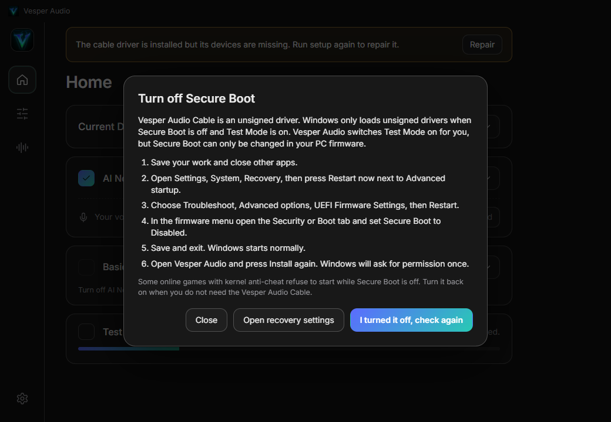

---

## Real Windows properties

| Control | Mechanism |
| --- | --- |
| Format, channels | `PKEY_AudioEngine_DeviceFormat` from the endpoint property store |
| Levels | `IAudioEndpointVolume` master scalar |
| Listen to this device | endpoint property `{24dbb0fc-9311-4b3d-9cf0-18ff155639d4},1` |
| Allow processing or bypass (audio enhancements) | undocumented `IPolicyConfig::SetPropertyValue` on the FX store, key `PKEY_AudioEndpoint_Disable_SysFx` `{1da5d803-d492-4edd-8c23-e0c0ffee7f0e},5` |
| Cable name and icon | `IPolicyConfig::SetPropertyValue` on the endpoint store (string values must be `VT_LPWSTR`) |
| Displays (second monitor) | `EnumDisplayDevices`, `EnumDisplaySettings` and `ChangeDisplaySettingsEx` through the helper |
| Firewall rule | `netsh advfirewall`, program scoped, private and domain profiles |

None of the endpoint properties need administrator rights. Installing a driver, trusting a publisher and adding a firewall rule do.

---

## Tests and benchmarks

| Suite | What it checks | Result |
| --- | --- | --- |
| `npm test` | 31 checks in the real app with a fake audio device: boot, five pages, endpoints, noise reduction per mode, the gate and both loudness sliders, **a phone pairing with a QR code, becoming the microphone, muting, leaving**, **the screen reaching a phone as valid H.264**, Settings rows, soundboard, tray, persistence | all pass |
| `cargo test` in `core/` | 11 tests: QR pairing, a used QR code refused, short-code pairing needs the PC to confirm, declining refuses the phone, reconnect without pairing, forgetting, mute, audio with loss and reordering, screen frames over the link with valid parameter sets, converter checks, shared protocol vectors | all pass |
| Android unit tests | 4 tests: six-digit codes and AES-GCM packets identical to the Rust core, base64 | all pass, in CI on every build |
| `npm run test:lowend` | Two busy cores pinned to the app: the chosen preset must not change, the backlog stays bounded, no setting changes | all pass |

A stand-in phone (`fakephone`, part of `core/`) speaks the same protocol as the Connector, so the whole PC side is tested without a phone.

DNSMOS of the shipped base models (P.835, 6 clips from 3 speakers at 5 dB SNR with 11 ESC-50 noise types, 1.0.0 measurement): noisy input 2.06 overall, DeepFilterNet3 2.43, DPDFNet baseline (ClearCast) 3.00, clean reference 2.91.

---

## Architecture

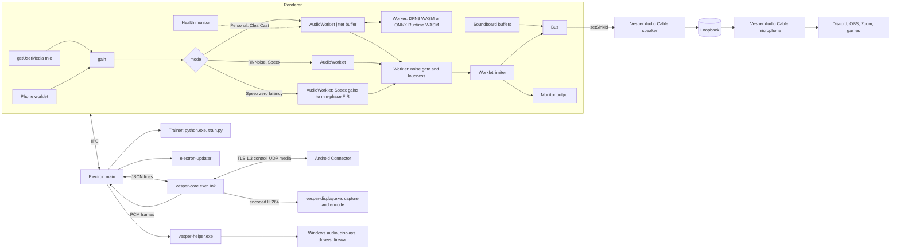

* The audio engine lives in the renderer. Background throttling is off, so it keeps running while the window is hidden in the tray.
* Denoisers run in a Worker connected to an AudioWorklet by a `MessageChannel`. The worklet owns an adaptive jitter buffer.
* The renderer cannot open network connections (its content security policy blocks them), so all networking lives in the link component, which the app starts as a child process and talks to with one JSON message per line.
* The link component never decodes video. The display process writes encoded frames to its output, the link cuts, encrypts and sends them.
* With Test and Hear Yourself off, the audio context outputs directly to the cable. With it on, the context outputs to the monitor device and the cable is fed by a second stream.

---

## Build from source

Prerequisites: Node 22, Rust stable, `rustup target add wasm32-unknown-unknown`, `cargo install wasm-bindgen-cli --version 0.2.92 --locked`. For the Android app: JDK 17, the Android SDK (platform 36, build tools 36.0.0) and Gradle 8.14.

```powershell
npm ci
npm run build:df
npm run helper
npm run core
npm start
npm test
npm run dist
```

| Script | Does |
| --- | --- |
| `build:df` | Clones DeepFilterNet at a pinned commit, builds its WASM with SIMD, downloads and checks the full and the low latency model. |
| `helper` | Builds `vesper-helper.exe` with Cargo. |
| `core` | Builds `vesper-core.exe`, `vesper-display.exe` and the stand-in phone `fakephone.exe` in release mode. Needed before `npm test` runs the phone checks, and before `npm run dist`. |
| `start` | Runs the app. In this repo's shell `ELECTRON_RUN_AS_NODE` must be unset. |
| `test`, `test:lowend` | Launch the real app with a fake audio device and check behavior. |
| `dist` | NSIS installer, portable exe, `latest.yml` and blockmap into `dist/`. It packs `vesper-helper.exe`, `vesper-core.exe`, `vesper-display.exe` and the APK (`android-dist/Vesper-Audio-Connector.apk`) as extra resources. |

The Android app:

```powershell
cd android
gradle assembleRelease testReleaseUnitTest
```

Without the signing variables the release build is signed with the debug key, which is fine for trying it. With `ANDROID_KEYSTORE_FILE`, `ANDROID_KEYSTORE_PASSWORD`, `ANDROID_KEY_ALIAS` and `ANDROID_KEY_PASSWORD` set it signs with your key. Copy the APK to `android-dist/Vesper-Audio-Connector.apk` before `npm run dist` to bundle it.

Running the core by hand and the trainer:

```powershell
core\target\release\fakephone.exe --qr "<vesper://pair... from the app>" --mode display --seconds 10 --dump screen.h264
core\target\release\vesper-display.exe --seconds 4 --dump screen.h264
python training/train.py --base DeepFilterNet3_ll_onnx.tar.gz --clean my_recordings --noise corpus/noise --speech corpus/speech --out personal.tar.gz --steps 360
python tools/build-trainer.py --out build/trainer --corpus build/corpus
```

The fallback audio driver needs the Windows Driver Kit and Visual Studio 2022. It is built by CI (`windows-2022`), not locally.

---

## CI and releases

`.github/workflows/release.yml` builds everything and attaches it to one release.

| Job | Output |
| --- | --- |
| `driver` | WDK build, sign `.sys`, regenerate and sign `.cat`, zip with the certificate, SHA-256 file |
| `android` | Gradle build of the Connector, JVM unit tests, `apksigner` check, `Vesper-Audio-Connector.apk` and its SHA-256 |
| `app` | DeepFilterNet WASM, Rust helper and link component (with their tests), NSIS installer and portable exe with the APK inside, update metadata |
| `publish` | One GitHub release with all assets. A tag with a dash (for example `v2.1.0-rc.1`) is published as a pre-release |

```powershell
git tag v2.0.0
git push origin v2.0.0
```

Repository secrets used by the `android` job: `ANDROID_KEYSTORE_B64` (the base64 of the keystore), `ANDROID_KEYSTORE_PASSWORD`, `ANDROID_KEY_ALIAS`, `ANDROID_KEY_PASSWORD`. Keep an offline backup of the keystore: without it the app can no longer be updated over an installed copy. Manual runs (`workflow_dispatch`) take `target` (`all`, `driver`, `app`, `android`) and `publish` (default false), so a build can be checked without releasing.

Two pre-releases hold large files the app downloads: `models-v1` (the speaker model from 1.1.0) and `trainer-v1` (the trainer package). Both are pre-releases so the updater's "latest" lookup never picks them up.

---

## Data and privacy

Everything runs on your PC and your own network. The only internet traffic is downloads: the VB-CABLE package from vb-audio.com, the virtual display driver package from its GitHub release, the fallback driver, the trainer package, models, and release lookups for updates. No telemetry. Phone audio and the screen go only to phones you paired, encrypted, over your local network.

| Path (`%APPDATA%\Vesper Audio`) | Content |
| --- | --- |
| `settings.json` | All settings and which personal model is active |
| `link/identity.cert`, `link/identity.key` | This PC's link certificate and its private key |
| `link/paired.json` | Paired phones: name, model and certificate fingerprint |
| `voice/train`, `voice/val` | Your voice recordings, wiped when you record again |
| `models/personal-<id>.tar.gz` | Your trained model |
| `trainer/pack` | Unpacked trainer package (about 530 MB) |
| `sounds/` | Copies of your soundboard files |

On the phone, the pairing key lives in the Android Keystore and the paired PC (address, fingerprint, name) in the app's private storage. `Documents\Vesper Audio Diagnostics` holds diagnostic recordings you made. `C:\VirtualDisplayDriver` holds the virtual display driver's settings. Delete `voice/`, `trainer/`, `link/` and the `personal-*` files to forget your voice and your phones.

---

## Troubleshooting

| Symptom | Cause and fix |
| --- | --- |
| The phone says it cannot reach the PC | Both must be on the same Wi-Fi (not a guest network that isolates devices). Open Vesper Audio on the PC, press **Allow in Windows Firewall** in Settings, and scan a fresh code. Typing the PC address under **Connect by address** works when discovery is blocked. |
| The QR code is refused | It works once and for two minutes. Press **New code**. |
| The six-digit codes differ | Press Cancel on both and start again. Do not pair unless they match. |
| No PCs listed under nearby | Some routers block multicast. Use the QR code. |
| Phone audio stops with the screen off | Allow background use for the Connector (the button on its main screen). Some phone makers add extra battery savers, whitelist the app there too. |
| Phone microphone crackles | Move closer to the router or use 5 GHz. The jitter buffer grows on its own and shrinks again. |
| The phone is selected but silent | Check the phone says **Microphone is on** and not muted, and that the Home device shows **connected**. |
| The second monitor never starts | On the phone open **Use as second monitor** first, then press **Use as second monitor** on the PC. Check the PC can capture the screen (a UAC prompt or the lock screen blocks capture and the picture resumes by itself). |
| Second monitor shows my main screen | The virtual display driver is not installed, so it mirrors. Install it from Second Monitor or Settings. |
| The virtual display driver installs but shows nothing | Restart Windows once. If you updated your graphics driver recently, remove the virtual display driver first and install it again. |
| Black or confusing screens after a graphics driver update | Remove the virtual display driver (Settings, Uninstall) and reinstall it. |
| Vesper Audio Cable not in other apps | Check the banner on Home. Install not finished: press **Install**. Restart needed: press **Restart**. |
| Cable still says VB-Audio | Restart the app. Branding finishes on launch for a cable that Vesper installed. |
| My voice is delayed | Personal is about 45 ms and ClearCast about 90 ms. Use **Speex zero latency** for none. |
| Audio crackles or lags on a weak PC | Pick ClearCast or a Basic mode. Personal needs the most CPU. |
| Training exits with code 3221225781 | Windows is missing the Microsoft Visual C++ Redistributable. Install the current x64 version. |
| Echo or feedback | **Test and Hear Yourself** is on with speakers. Use headphones or untick it. |
| Updates say "installed builds only" | You are running from source. Updates apply to the installer and portable builds. |

---

## Honest limits

* **The Android app has not been run on a real phone by its author.** There is no Android device or emulator in the build environment. It builds, its unit tests pass in CI, and its encryption and codes are proven identical to the PC side, and the whole PC side is tested with a stand-in phone that speaks the same protocol. How the real app behaves on real phones (the permission flow, the foreground service, the screen-off behavior, the decoder, battery savers of specific brands) is untested. Please report problems.
* **Phone microphone latency and second monitor latency have not been measured end to end on real hardware.** The stage numbers above are measured or estimated, the glass-to-glass number is not known.
* **The virtual display driver was not installed in the build environment** because that needs an administrator click. Its package signature was verified (valid, SignPath Foundation) and the helper commands were exercised for the status and listing parts. A SignPath-signed user-mode driver should load with Secure Boot on, but that was not confirmed here.
* The second monitor uses the Windows software H.264 encoder. A weak CPU will feel it. It has no touch input, no audio, and one phone at a time.
* **The native audio engine and Bluetooth discovery that were planned are not in 2.0.0.** Discovery uses mDNS, the QR code, a typed address and the six-digit code.
* The phone microphone uses PCM audio and Android's standard recorder, not a compressed codec or the lowest-latency native recorder.
* **Personal is the most expensive mode** (about 7 to 13 ms of CPU per 10 ms of audio here). On a weak PC it will crackle, and the app will not switch for you. Pick ClearCast or a Basic mode.
* The base models are open source and were not trained by this project. There is no head-to-head claim against NVIDIA Broadcast or any commercial product.
* **The personal voice model quality numbers come from one English speaker** used as a stand-in. Hindi and real users have not been measured.
* The noise gate has no lookahead, so the first few milliseconds of a word after silence can be softened. Loudness normalization was measured on tones and one synthetic voice.
* The in-app updater was not tested end to end until the first update from a published version.
* There is no Microsoft-signed Vesper driver. The default cable is VB-CABLE, signed by Microsoft. The Vesper kernel loopback is signed with a self-signed certificate and has not been exercised on the author's PC (Secure Boot on).
* The Vesper executables are not Authenticode signed, so SmartScreen or an antivirus may warn, especially about the programs that listen on the network.

---

## Repository layout

```
.github/workflows/release.yml   build and release everything
android/                        Vesper Audio Connector (Kotlin): link, mic sender, screen viewer, unit tests
core/                           Rust: vesper-core (link), vesper-display (capture and H.264), fakephone (test phone), tests
docs/                           screenshots and protocol.md
driver/                         fallback WDM audio driver fork
helper/                         Rust helper: audio endpoints, branding, displays, drivers, firewall
proto/vectors.json              protocol test vectors shared by the Rust and Kotlin tests
scripts/                        vendor.js, build-df.js, zero-speex.part.js, test.js, lowend.js
src/main.js, preload.js         Electron main process, tray, IPC, priority and power handling
src/core.js, apk.js, display.js link component supervisor, APK server, virtual display driver install
src/trainer.js, wav.js          trainer download, training child process, validation, recordings
src/updater.js, driver.js, models.js, winaudio.js   updates, driver and model downloaders, helper wrapper
src/ui/engine.js                audio graph, health monitor, phone input
src/ui/phones.js                pairing, Add phone mic, Second Monitor page, Settings rows
src/ui/phone.worklet.js         phone microphone playout with jitter buffer
src/ui/dynamics.worklet.js      noise gate and loudness normalization
src/ui/limit.worklet.js         limiter
src/ui/denoise.worklet.js, denoise.worker.js   jitter buffer and denoiser worker
src/ui/personal.js, diag.js     training dialog and diagnostic recorder
training/                       onnxexec.py, dfn.py, data.py, losses.py, train.py, evaluate.py, build_corpus.py
tools/build-trainer.py          builds the trainer package
```

---

## Licenses and credits

This project: MIT (see [LICENSE](LICENSE)). Developed by Ayush.ue5.

| Component | License |
| --- | --- |
| Electron, ONNX Runtime, electron-updater | MIT |
| DeepFilterNet (base model and runtime) | MIT or Apache-2.0 |
| DPDFNet (Ceva-IP, ClearCast) | Apache-2.0 |
| PyTorch, NumPy, ONNX (trainer package) | BSD-3-Clause, BSD-3-Clause, Apache-2.0 |
| @sapphi-red/web-noise-suppressor, RNNoise, SpeexDSP | MIT, BSD-3-Clause |
| Virtual Display Driver (VirtualDrivers, MikeTheTech), signed by the SignPath Foundation | MIT |
| rustls, rcgen, aes-gcm, sha2, mdns-sd, if-addrs, serde and the windows crate | Apache-2.0 or MIT |
| qrcode-generator (Kazuhiko Arase) | MIT |
| Google code scanner (Google Play services) | Google APIs terms |
| Virtual-Audio-Driver (MikeTheTech) | MIT |
| VB-CABLE | VB-Audio Software, donationware, downloaded from vb-audio.com at install time and never redistributed here |
| Microsoft SysVAD sample | MS-PL |
| Inter font | OFL-1.1 |
| Lucide icons | ISC |

Data in the trainer package (`corpus/LICENSES.txt` has the same list): DEMAND noise database (CC BY 4.0), LibriSpeech dev-clean (CC BY 4.0), OpenSLR SLR104 Hindi-English code-switching test set (CC BY-SA 4.0). Microsoft DNSMOS and ESC-50 were used for benchmarking only and are not redistributed.

The files under `driver/Source` keep their original headers and notices as required by the upstream licenses.
